<p align="center">
  
</p>

<p align="center">
  <strong>Your code looks right. Is the math?</strong>
</p>

<p align="center">
  <a href="https://pypi.org/project/pycodemath/"></a>
  <a href="LICENSE"></a>
  
  
  
  <a href="https://github.com/cybersora9/pycodemath/actions/workflows/ci.yml"></a>
</p>

<!-- mcp-name: io.github.cybersora9/pycodemath -->

**Pycodemath checks the math in your Python code.** Give it a function and the
formula it should compute. You get a proof that they match, or the exact input
that breaks the function. No guessing, no random samples.

```bash
pip install pycodemath
```

```python
# example.py
from pycodemath import check_code

SRC = '''
def sum_to(n: int) -> int:      # should return 0 + 1 + ... + n
    total = 0
    for k in range(n):          # off by one: stops at n-1
        total += k
    return total
'''

if __name__ == "__main__":      # needed on Windows: your function runs in a worker process
    r = check_code(SRC, "n*(n+1)/2")
    print(r.verdict)               # refuted
    print(r.counterexample.call)   # sum_to(n=1)
    print(r.reason)                # sum_to(n=1) returns 0, the formula gives 1 ...
```

`REFUTED` always comes with a concrete input that was really executed (the
*witness*). `VERIFIED` is a proof. Anything else is `UNDECIDED`, with a reason.
Fix the loop to `range(n + 1)`, tell it `n` is a non-negative integer
(`domain={"n": "integer, n>=0"}`), and the same call comes back `VERIFIED`.

Pycodemath is also an exact math engine and an MCP server for AI agents
(SymPy + NumPy): write math in a few characters, get an exact answer or
standalone, optimized Python/NumPy code back, instead of asking a language model
to "do arithmetic in its head".

*Polska wersja tego dokumentu: [README.pl.md](README.pl.md).*

**Contents:**
[Check the math in your code](#check-the-math-in-your-code) ·
[Install](#install) ·
[First run](#first-run) ·
[Quick start](#quick-start) ·
[Verify](#verify-check-instead-of-compute) ·
[Results you can branch on](#results-you-can-branch-on) ·
[Code generation](#code-generation) ·
[Design contracts](#design-contracts)

## Four checks in 0.5.1, in one minute

**1. A solver that silently drops a root.** `exp(x) = 3x` has two real solutions;
SymPy's `solve` returns one. `certify` re-checks the answer and finds the missing root:

```console
$ python -m pycodemath "certify solve exp(x) = 3*x for x"
-LambertW(-1/3)
certificate: REFUTED (sign-scan) — a root is missing: the expression changes sign at x ≈ 1.51213455165784 (confirmed at 30 and 60 digits), where no listed root lies
```

**2. A system of equations, with proof the list is complete:**

```console
$ python -m pycodemath "solve x^2 + y^2 = 25, x + y = 7 for x, y"
x = 3, y = 4; x = 4, y = 3
  proof: every solution substituted gives 0; the number of distinct complex solutions equals the dimension of Q[vars]/radical(I) (Seidenberg), so the list is complete
certificate: VERIFIED (groebner) — every solution substituted gives 0; the number of distinct complex solutions equals the dimension of Q[vars]/radical(I) (Seidenberg), so the list is complete
```

**3. A formula that loses precision, rewritten and proved equal:**

```console
$ python -m pycodemath "improve sqrt(x+1)-sqrt(x) for x in [1e6, 1e12]"
1 / (sqrt(x + 1) + sqrt(x)): 28.5 -> 0.4 bits of error on average (39.9 -> 1.6 at worst), proved by check_equal
  proof: verified (check_equal) — left - right simplifies to 0; agree numerically at 32 of 32 sample points
certificate: VERIFIED (symbolic) — left - right simplifies to 0; agree numerically at 32 of 32 sample points
```

**4. Money split to the cent, with no lost grosz:**

```console
$ python -m pycodemath "money split 100 PLN into 3"
33.34 + 33.33 + 33.33 = 100.00 PLN  (hamilton; sums exactly: True)
certificate: VERIFIED (exact) — shares sum to the total exactly (rational sum); zero weights get zero; every share within one unit of its quota; equal split: spread <= one unit; shares re-added in exact fractions
```

88 commands in 11 sections: run `pycodemath commands` for the full list, or `pycodemath tour`.

## What it does

Built as a thin, disciplined layer over SymPy + NumPy:

1. **Cut tokens** — one short command in, one exact result out. Perfect as an
   agent tool (MCP server included).
2. **Better code than naive Python** — the generator applies symbolic
   simplification + common-subexpression elimination (CSE) before emitting
   code (measured ~1.7x faster than naive expansion on repeated
   subexpressions).
3. **Answers you can branch on** — a failure is a TYPE, not a message, and a
   numerical answer can hand back the evidence behind it. See
   [Results you can branch on](#results-you-can-branch-on).
4. **Check instead of compute** — an identity, a derivation step by step, or
   an engine answer, judged VERIFIED / REFUTED (with a counterexample) /
   UNDECIDED. See [Verify](#verify-check-instead-of-compute).
5. **Check the math in your code** — a function against its formula, float
   accuracy, overflow, money, units and geometry, each with a witness or a
   proof. See [Check the math in your code](#check-the-math-in-your-code).

```
text → [parser] → IR (expression tree) → [engine]     evaluate / simplify / solve
                                       → [generator]  IR → CSE → Python/NumPy source
```

## Check the math in your code

Code that computes a formula can be checked like an identity. Pycodemath reads a
Python function, proves it equal to the formula it should compute, or hands back
the **exact call that breaks it** — really executed, never "it disagreed on some
random samples". The same contract runs through every check below: **VERIFIED**
is a proof, **REFUTED** always carries a concrete witness checked exactly, and
anything else is **UNDECIDED** with a reason. Every answer ends with a
`certificate:` line — the check written down, re-runnable from the file alone
(see [Certificates](#certificates-a-check-anyone-can-re-run)).

**Does this function compute that formula?** The classic off-by-one:

```pycon
>>> from pycodemath import check_code, emit_test
>>> src = "def sum_to(n: int) -> int:\n    total = 0\n    for k in range(n):\n        total += k\n    return total\n"
>>> r = check_code(src, "n*(n+1)/2")
>>> r.verdict, r.counterexample.call
('refuted', 'sum_to(n=1)')
>>> r.reason
'sum_to(n=1) returns 0, the formula gives 1 — confirmed by executing the function and evaluating the formula exactly'
>>> check_code(src, "n*(n-1)/2", domain={"n": "integer, n>=0"}).verdict
'verified'
>>> "assert sum_to(n=1) == 1" in emit_test(r, module="sums")
True
```

Correct code comes back VERIFIED with a proof (symbolic, branch by branch, or an
exact certificate for integer code with `//` and `%`). Float rounding alone never
counts as a bug here — that is what `stability` is for. `emit_test` writes the
pytest that pins the counterexample. From the shell, on your own file (its
function is executed in an isolated worker to confirm a refutation):

```bash
python -m pycodemath "verify code sums.py:sum_to == n*(n+1)/2 --emit-test"
python -m pycodemath "verify code sums.py:sum_to == n*(n-1)/2 where n: integer, n>=0"
```

**Floating-point accuracy, with proof.** How many bits does float64 lose, where,
and why — and a rewrite that is **proved equal** and **measured** better:

```console
$ python -m pycodemath "stability sqrt(x + 1) - sqrt(x) for x in [1e10, 1e15]"
sqrt(x + 1) - sqrt(x) [float64]: loses 41.0 bits on average (max 49.9); worst at {'x': '510800533960562.3'}
  worst: at x = 510800533960562.3 computes 1.862645149230957e-08, exact 2.2123015980434279398e-8 (49.9 bits)
  culprit: sqrt(x + 1) - sqrt(x) — cancellation: subtracting nearly equal values (41.0 bits on average); try p - sqrt(q) -> (p^2 - q) / (p + sqrt(q)) (conjugate)
certificate: REFUTED (re-evaluation) — at x = 510800533960562.3: float64 computes 1.862645149230957e-08 (emitted NumPy code), exact 2.2123015980434279398E-8 (SymPy, 40 digits): 49.9 bits lost (more than 3)
```

```pycon
>>> from pycodemath import diagnose, improve
>>> rep = diagnose("sqrt(x + 1) - sqrt(x)", {"x": (1e10, 1e15)})
>>> round(rep.mean_bits, 1), rep.culprits[0].cause
(41.0, 'cancellation: subtracting nearly equal values')
>>> imp = improve("sqrt(x + 1) - sqrt(x)", {"x": (1e10, 1e15)})
>>> imp.best.expression, imp.best.proof.status, round(imp.best.mean_bits, 1)
('1 / (sqrt(x + 1) + sqrt(x))', 'verified', 0.4)
```

`improve ... emit python|numpy|c` prints the code that computes exactly what was
measured. No rewrite is ever returned without a proof. Compared with Herbie on the
11 Hamming benchmarks the optimizer was not tuned on: 7.25 bits of error
left vs 8.08 for Herbie's outputs (better on 3, worse on 5, tied on 3) — against
Herbie's published 2017 report (the 1.1 era), not today's Herbie 2.x, which could
not be installed in the measuring environment.

**Will it overflow?** The 2006 binary-search bug, with the input that breaks it
(executed in NumPy int32) and a fix that is proved equivalent:

```console
$ python -m pycodemath "ranges (lo + hi) // 2 for lo in [0, 2^31-1], hi in [0, 2^31-1] as int32"
(lo + hi) // 2  [int32]  -> problems
  confirmed overflow                   lo + hi at {'hi': '2147483647', 'lo': '2147483647'} -> -2
  advice: lo + (hi - lo) // 2 [int32] removes overflow
  advice: (lo + hi) // 2 [int64] removes overflow
  advice proof: lo + (hi - lo) // 2 — verified (symbolic (integer parity cases))
  advice proof: (lo + hi) // 2 — verified (same expression)
certificate: REFUTED (execution) — overflow at lo + hi: lo + hi at hi=2147483647, lo=2147483647: got -2, exact 4294967294

$ python -m pycodemath "maxsafe exp(x) for x as float32"
x <= 88.72283172607422 is safe in float32 (exact bound 11629079/131072; interval/exhaustive proof below, executed witness above)
  first failure: exp(x) at x=88.72283935546875: got inf, exact 3.4028244988034356558e+38
  x <= 88.72283172607422 is proved safe; x = 88.72283935546875 fails (overflow at exp(x))
certificate: VERIFIED (proof) — no event in float32 over the given ranges
```

int8…uint64, float16, bfloat16, float32, float64: overflow, underflow,
subnormals, NaN, division by zero, lost integer precision (`for t_ms in [0, 2^31-1]
int as float32` — millisecond timestamps in float32). "Safe" is a proof, not a
guess. In Python: `pycodemath.code.analyze(expr, ranges, dtype)` and
`max_safe_input`.

### Calculator that proves its answers

```console
$ python -m pycodemath "factor 2^64+1"
274177 * 67280421310721
certificate: VERIFIED (proof) — product of the factors equals 18446744073709551617 exactly; each factor is proven prime; re-multiplied: the factors give the number back

$ python -m pycodemath "special zeta 3 digits 50"
1.2020569031595942853997381615114499907649862923405
certificate: VERIFIED (cross-check) — precision ladder: values at 65 and 130 digits agree; Euler-Maclaurin summation agrees with the default (Borwein) algorithm

$ python -m pycodemath "var sample 1 2 3 4"
5/3
certificate: VERIFIED (proof) — exact rational sample variance over a common denominator
```

Primality is proved (deterministic Miller–Rabin below 3.3·10²⁴, Lucas–Lehmer or
a re-checkable Pocklington certificate above it; anything only BPSW-probable is
UNDECIDED and says so). Number theory, combinatorics, 13 special functions at any
precision, exact descriptive statistics, 7 distributions and an A/B toolkit
(`samplesize`, `power`, `ci wilson|exact`, `ztest`, `welch`, `holm`) whose
answers always carry the peeking and multiple-comparison warnings. In Python:
`pycodemath.calc` and `pycodemath.stats`.

### Units and dimensions

```console
$ python -m pycodemath "5 km/h to m/s"
25/18 m/s ≈ 1.38888888888889 m/s
certificate: VERIFIED (exact-conversion) — 5 km/h = 25/18 m/s ≈ 1.38888888888889 m/s (dimension ratio 1, exact round trip; sympy.physics.units agrees: True)

$ python -m pycodemath "units F = m*v where F:N m:kg v:m/s"
REFUTED (dimensional-analysis) — left is kg·m/s² (force), right is kg·m/s (momentum)
  left: kg·m/s²; right: kg·m/s
certificate: REFUTED (dimensional-analysis) — left is kg·m/s² (force), right is kg·m/s (momentum)
```

Units are a verification signal, not only a converter: `check_dimensions("F",
"m*v", {"F": "N", "m": "kg", "v": "m/s"})` is refuted with a witness. Absolute
°C/°F are never scaled silently, `KB`, `month`, `dB` are refused as ambiguous,
and `rad/s` is not `Hz`. In Python: `pycodemath.convert`, `check_dimensions`,
`dimension_of`, `pycodemath.units`.

### Money: no lost cents

```console
$ python -m pycodemath "money split 100 PLN into 3"
33.34 + 33.33 + 33.33 = 100.00 PLN  (hamilton; sums exactly: True)
certificate: VERIFIED (exact) — shares sum to the total exactly (rational sum); zero weights get zero; every share within one unit of its quota; equal split: spread <= one unit; shares re-added in exact fractions

$ python -m pycodemath "money float round(x*1.23, 2) for x in 0.01..50.00 currency PLN"
float gives 0.61 where exact decimal arithmetic gives 0.62; e.g. the literal 1.23 is stored as 1.229999999999999982236431605997495353221893310546875
  witness: at x = 0.50 floats give 0.61, exact 0.62 (22 of 5000 inputs wrong)
certificate: REFUTED (execution) — float gives 0.61 where exact decimal arithmetic gives 0.62; e.g. the literal 1.23 is stored as 1.229999999999999982236431605997495353221893310546875

$ python -m pycodemath "money irr -100,230,-132"
IRR: 10%, 20% (2 rates — the IRR is not unique; exact brackets [['1/10', '1/10'], ['1/5', '1/5']])
certificate: VERIFIED (exact) — sign change (or exact zero) of the square-free factor on every bracket; root count == Sturm count on (0, inf); Descartes' rule of signs: bound and parity; each rate within 10^-12 of the true root
```

Also `money round` (8 named modes, cash steps), `money vat` (per line vs on the
total, with the proven worst case), `money interest` (compounded once per month,
year or period, as given — the answer says which), `money loan` (the last
instalment corrects the rounding) and `money npv`. `for 25 years` is the
duration of a loan paid monthly — 300 instalments; add `yearly` for one
instalment a year:

```console
$ python -m pycodemath "money loan 300000 PLN at 7.2% for 25 years"
300 monthly instalments: payment 2158.77 PLN, last 2155.59; total paid 647627.82, interest 347627.82 (instalment x count differs by -3.18)
certificate: VERIFIED (exact) — principal parts sum to the loan exactly; payments == interest + principal; every row: payment == interest + principal; balance never negative, ends at 0
```

No floats inside: exact fractions, `Decimal` at the currency's ISO 4217 scale. In Python: `allocate`,
`round_money`, `float_money_hazard`, `pycodemath.money`.

### Geometry and graphics

```console
$ python -m pycodemath "rotcheck q1*q2 == R2@R1"
REFUTED (exact-witness) — the two sides differ at 1 = (1, 2, 3, 4) / sqrt(30), 2 = (2, -1, 1, 3) / sqrt(15)
  likely cause: multiplication order reversed (q1*q2 applies q2 FIRST; R1@R2 applies R2 first); row-vector (v@M) matrices read as column-vector (M@v) ones, or vice versa
certificate: REFUTED (exact-witness) — multiplication order reversed (q1*q2 applies q2 FIRST; R1@R2 applies R2 first); row-vector (v@M) matrices read as column-vector (M@v) ones, or vice versa

$ python -m pycodemath "epsilon orient2d 1e-9"
REFUTED — 2 witness(es), each re-executed in floats and decided exactly
  false_degenerate: input [[0.0, 0.0], [1.0, 0.0], [0.5, 4.656612873077393e-10]] — the epsilon test says collinear, exactly ccw
  wrong_sign: input [[128.00000000000117, 128.00000000000136], [3072.0, 3072.0], [6144.0, 6144.0]] — the epsilon test says cw, exactly ccw
certificate: REFUTED (exact-witness) — 2 witness(es), each re-executed in floats and decided exactly
```

Rotations without convention roulette (`quat2mat`, `euler2mat`, `mat2euler`, all
24 Euler conventions), predicates that never lie (`orient2d`, `orient3d`,
`incircle`: Shewchuk's filter with an exact fallback), CSS `easing` with a proved
enclosure, Bézier `arclength` with a rigorous bracket, and `emit` of every formula
as Python, NumPy, C and GLSL, executed against the certified implementation. In
Python: `compare_rotation_expressions`, `orient2d`, `pycodemath.geometry`.

### Numbers you can trust

An exact answer comes with its decimal, and the decimal is **proved**: every
digit printed is the correctly rounded value, decided by interval arithmetic
(`sqrt(2)/2  ≈ 0.707106781186548`). `evalf <expr> <digits>` and `N(<expr>,
<d>)` ask for more digits; `identify` recognises a constant only when enough
digits exclude a coincidence:

```console
$ python -m pycodemath "evalf exp(pi*sqrt(163)) - 640320^3 - 744 15"
≈ -7.49927402801814e-13
  15 digits, interval (rigorous)
certificate: VERIFIED (interval) — rigorous interval enclosure at 178 bits rounds to the same 15 digits at both ends

$ python -m pycodemath "identify 1.6449340668482264"
1.6449340668482264: UNDECIDED — best candidate pi**2/6 is consistent with the 17 digits given, but 17 < 50 digits cannot exclude a coincidence
  candidate pi**2/6  (deviation -3.65e-17, agrees on 16 digits, margin 11.5)
  warning: only 17 significant digits: the 150 families searched hold far more than 10^17 formulas with small coefficients, so a match to 17 digits happens by chance (the 'strong law of small numbers' — numerology); give at least 50 digits to recognise a constant
certificate: UNDECIDED (pslq+enclosure) — best candidate pi**2/6 is consistent with the 17 digits given, but 17 < 50 digits cannot exclude a coincidence
```

Where no rigorous enclosure exists (`besselj`, a non-integer `zeta`), the digits
are an agreement of two precisions and say so — `rigorous: false`, a certificate
that is UNDECIDED, never VERIFIED:

```pycon
>>> from pycodemath import approx, identify
>>> a = approx("besselj(0, 1)")
>>> a.value, a.method, a.rigorous
('0.765197686557967', 'stable-doubling', False)
>>> identify("zeta(2)").value
'pi**2/6'
```

Measured: `sympy.nsimplify` "recognises" 60 of 60 random 16-digit
numbers; `identify` claims 0 of the same 60. In Python: `approx`, `evalf_to`,
`dual`, `identify`.

### Inequalities, systems, definite integrals — every answer proved

The real line is cut at every zero and every domain boundary, each cut point is
decided exactly (in or out), and each open cell is proved to keep one sign. A
system comes with a completeness argument; an integral through a pole is found
to diverge instead of being stepped over (`[-1/x] = -2` is impossible here); a
convergent one is returned only when its closed form agrees with an independent
high-precision quadrature, and one with no closed form answers *converges,
value ≈ …*:

```console
$ python -m pycodemath "solve x^2 - 3x + 2 < 0"
x ∈ (1, 2)
  proof: sign decomposition (exact-roots) — 3 cells, 2 endpoints decided exactly
certificate: VERIFIED (exact-roots) — sign decomposition (exact-roots): 3 cells, 2 endpoints decided exactly

$ python -m pycodemath "solve x + y = 3, x - y = 1 for x, y"
x = 2, y = 1
  proof: rank(A) = rank([A|b]) = 2; the solution set is an affine space of dimension 0 = n - rank, and the substituted family satisfies every equation identically in its 0 parameter(s)
certificate: VERIFIED (linear) — rank(A) = rank([A|b]) = 2; the solution set is an affine space of dimension 0 = n - rank, and the substituted family satisfies every equation identically in its 0 parameter(s)

$ python -m pycodemath "integrate 1/x^2 dx from -1 to 1"
diverges to oo
  singular points inside: 0
  the integral diverges to +oo by the limit comparison test — at 0-: lim t·f = oo (nonzero); at 0+: lim t·f = oo (nonzero)
certificate: VERIFIED (proof) — the integral diverges to +oo by the limit comparison test — at 0-: lim t·f = oo (nonzero); at 0+: lim t·f = oo (nonzero)

$ python -m pycodemath "solve sin(x) = 1/2 all"
x = pi/6 + 2*pi*k, x = 5*pi/6 + 2*pi*k, k ∈ ℤ
  proof: period 2*pi (the two sides are identical after automatic simplification); solutions in one period complete (sign decomposition)
certificate: VERIFIED (interval-arithmetic) — period 2*pi proved (the two sides are identical after automatic simplification); the solutions in one period proved complete by sign decomposition
```

`reduce x^2 < 4 for x` reads the same; `for x in [0, 2*pi]` bounds a
trigonometric inequality; the Cauchy principal value only on request (`pv`).
Where SymPy has no closed form, the Bose–Einstein and Fermi–Dirac integrals
`∫_0^oo x^(s-1)/(e^(cx) ∓ 1) dx` are closed by their known values `Γ(s)ζ(s)/c^s`
and `(1-2^(1-s))Γ(s)ζ(s)/c^s` (`integrate x^3/(exp(x)-1) dx from 0 to oo` gives
`pi**4/15`) — and still checked against the quadrature like any other answer. On
an evaluation set of 96 cases: 0 verified wrong answers, against 3 for raw
SymPy 1.14 and 5 for Maxima 5.46. In Python: `solve_inequality`, `solve_system`,
`periodic_solutions`, `definite_integral`.

### How many times does this loop run?

`count_iterations(f)` reads the loops and returns the exact count, the region
where it holds and Θ proved by a limit — then runs the function and counts.
`check_iterations(f, "n**2")` catches an off-by-one with a real call. Recurrences
are solved with their conditions: the master theorem refuses `2T(n/2) + n/log n`
(the gap between cases 1 and 2) and Akra–Bazzi answers Θ(n log log n):

```console
$ python -m pycodemath "iterations tests/data/lint/dev/p504_zero_based_ok.py:sum_below == n + 1"
REFUTED (execution) — at n=0 the loop ran 0 times; the claim gives 1
  counted: n iterations
certificate: REFUTED (execution) — at n=0 the loop ran 0 times; the claim gives 1

$ python -m pycodemath "recurrence T(n) = 2*T(n/2) + n/log(n)"
Θ(n*log(log(n)))
  Akra–Bazzi: Θ(n*log(log(n))) by Akra–Bazzi (master theorem refused: master theorem does not apply: gap: f = Θ(n^1 log^-1 n) with k = -1 < 0 lies between case 1 and case 2)
  check: terms [('2', '1/2')]: a_i > 0, 0 < b_i < 1
  check: g(n) > 0 for all large n
  check: p = 1 solves sum a_i b_i^p = 1
  check: polynomial growth: lim n g'(n)/g(n) = 1 (finite), so g is regularly varying and g(u)/g(n) is bounded above and below for u in [b n, n]
  check: ∫_2^n g(u)/u^(p+1) du = log(log(n)) - log(log(2))
certificate: VERIFIED (Akra–Bazzi) — Θ(n*log(log(n))) by Akra–Bazzi (master theorem refused: master theorem does not apply: gap: f = Θ(n^1 log^-1 n) with k = -1 < 0 lies between case 1 and case 2)
```

```pycon
>>> from pycodemath import count_iterations, check_iterations
>>> src = "def pairs(n: int) -> int:\n    c = 0\n    for i in range(n):\n        for j in range(i):\n            c += 1\n    return c\n"
>>> r = count_iterations(src)
>>> str(r.main), r.valid_for, str(r.theta), r.certificate.points, r.certificate.agree
('n*(n - 1)/2', 'n >= 1', 'n**2', 39, True)
>>> check_iterations(src, "n**2/2").reason
'at n=1 the loop ran 0 times; the claim gives 1/2'
```

Also `complexity f.py:f is O(n log n)` (O, Theta, Omega, o, omega — decided by a
limit) and `master <a> <b> <f>`. On the evaluation set: SymPy's `rsolve` gives a closed
form for 5 of 20 recurrences and refuses every divide-and-conquer one; the
empirical `big_O` package names the right class for 10 of 17 loops (same
cases). The CLI runs YOUR file; over MCP (`math_iterations`) nothing runs
unless the agent passes `execute=true`.

### Lint the math in your repo

`python -m pycodemath.lint src/` (or the `pycodemath-lint` script) finds the
places where the mathematics in your code computes the wrong value — float
formulas that lose precision, integer overflow for a declared NumPy dtype,
`round()` and binary floats on money, `==` on floats, `^` used as a power, a
`range` off by one against the function's `:math:` formula. **Every finding
carries a witness**: a concrete input that was executed, and the exact value it
should have produced, computed independently. Where a fix exists it is proved
equal.

```console
$ python -m pycodemath "lint tests/data/lint/dev/p401_gross.py --concise --no-cache"
p401_gross.py:3:12: PCM401 binary floats change this amount: round(price * 1.23, 2) at price=0.50 = 0.61, exact 0.62 — use Decimal
p401_gross.py:3:12: PCM503 round() is half-to-even: round(price * 1.23, 2) at price=1.50 = 1.84, exact 1.85 with HALF_UP
Found 2 findings in 1 file.
certificate: REFUTED (witness) — PCM401 line 3: binary floats change this amount: round(price * 1.23, 2) at price=0.50 = 0.61, exact 0.62 — use Decimal (+1 more)
```

Exit codes as ruff (0 clean, 1 findings, 2 error — for `lint` only). Rules:
`--list-rules`, `--explain PCM401`. SARIF for GitHub code scanning: `--format
sarif` (example workflow in `examples/github-action/pcm-lint.yml`). pre-commit:
hook id `pycodemath-lint`. pytest: `pytest --pcm` checks every `:math:` /
`@spec` as a test (installed as a plugin that does nothing without the flag).
On the linter's held-out set: 13 of 13 expected findings, 0 false positives. In Python:
`lint_source`, `lint_paths`, `spec`, `LintConfig`.

### For agents: six more MCP tools

`math_eval` answers every line above (its payload gains `result` — the module's
own result object — and `certificate`). Five typed tools take what does not fit
one line: `math_check_code` (a function's source; **by default the code is only
read and proved, never run** — a refutation that needs running it stays
UNDECIDED until the agent passes `execute=true`), `math_iterations` and
`math_lint` (source too, the same `execute=false` default), `math_stability` and
`math_ranges` (a dict of variable ranges). `math_recheck` re-runs any
certificate. All six answer with the same six fields: `text`, `kind`,
`status`, `result`, `certificate`, `error`.

## Install

```bash
pip install -e .                  # core: sympy + numpy
pip install -e .[mcp]             # + MCP server for AI agents
pip install -e .[dev]             # + pytest
```

Requires Python ≥ 3.11. The package ships a `py.typed` marker, so everything
below is fully typed for an installed caller — including the overloads that
make `full_result=True` change the return type. No `cast()` anywhere.

## First run

The first time you run `pycodemath` in a terminal after installing or
upgrading, it plays a short intro, then runs your command as usual. It shows
once per installed version. Replay it any time:

```bash
pycodemath intro
```

<p align="center">
  
</p>

A short presentation: the logo, one live demo (a loop is read as a formula,
REFUTED with the call that really ran, fixed, then VERIFIED; every number comes
from the engine as you watch) and a map of what it can do, each area with a
command to paste. It animates only on a terminal; piped, or with `--static` or
`PYCODEMATH_NO_ANIM=1`, it prints the final screen. `NO_COLOR` is respected.
Flags: `--static`, `--no-logo`, `--once`.

It never shows by itself when stdout is not a terminal (scripts, pipes, AI
agents running a shell), never in the MCP server, and never with
`PYCODEMATH_NO_INTRO=1`. The version it was shown for is kept in
`intro-shown` in the user cache directory (`PYCODEMATH_CACHE_DIR` to move it).

Then find your way with:

```bash
pycodemath commands           # every command, by topic, one line each
pycodemath help money         # the help of one topic (solve, calculus, verify, code,
                              #   numbers, money, units, geometry, ode, stats)
pycodemath examples money     # 3-5 runnable examples of a topic
pycodemath tour               # five short live demos, Enter = next, q = quit
```

**For agents.** `pycodemath intro --once` shows the intro only if it has not
been shown for the installed version on this machine yet, and prints nothing
(exit 0) after that. Over MCP the same map comes from the `intro` tool, as
plain text and data. One-shot commands (`pycodemath "solve ..."`) never print a
banner off a terminal, so their output stays clean for scripts; only the
interactive REPL greets you, in two lines.

The SVG is recorded from the real command by `scripts/record_intro_svg.py`; the
terminal logo is rasterized from `assets/pycodemath-sygnet.svg` by
`scripts/gen_logo.py` (Pillow, offline; the package does not need it).

## Quick start

### One-shot CLI (scriptable)

Every command below is a real invocation with its real output.

```console
$ python -m pycodemath "diff sin(x)*x dx"
x*cos(x) + sin(x)

$ python -m pycodemath "integrate 2*x dx"
x**2

$ python -m pycodemath "solve x^2 - 4 for x"
-2, 2

$ python -m pycodemath "sin(x)^2 + cos(x)^2"
1

$ python -m pycodemath "eig [[2,1],[1,2]]"
3, 1

$ python -m pycodemath "solve_nd x^2+y^2-4; x-y for x,y at 1,1"
x = 1.4142135623746899, y = 1.4142135623746899
```

Errors go to stderr with exit code 1, results to stdout with exit code 0 —
safe to call from scripts and agent tools. On Windows consoles set
`PYTHONUTF8=1`.

### REPL

```bash
python -m pycodemath        # or just: pycodemath
```

Type `help` for the full command table (derivatives, integrals, equation
solving, matrices, root finding, optimization, the whole ODE suite, code
generation, and every check in [Check the math in your code](#check-the-math-in-your-code)).
Names are read strictly: `speed*time` has two variables, never ten letters; an
unknown command word is refused with "did you mean". In the REPL, `implicit on`
splits multi-letter names into letters (`2xy` = `2*x*y`) and `implicit off`
restores the default; a certificate records which mode its claim was read in.

### MCP server (math for any AI agent)

```bash
claude mcp add pycodemath -- uvx --with "mcp>=1.0,<2.0" pycodemath mcp
```

Or from a regular install: `pip install pycodemath[mcp]`, then
`claude mcp add pycodemath -- pycodemath mcp`. Also listed in the
[MCP Registry](https://registry.modelcontextprotocol.io) as
`io.github.cybersora9/pycodemath`.

Exposes `math_eval`, that accepts the same commands as the REPL —
an agent sends `diff sin(x)*x dx` and receives `x*cos(x) + sin(x)` exactly,
with zero mental arithmetic. What it sends BACK is
[a structured response](#from-an-agent-the-mcp-response), not just prose.
Its twin, `math_verify`, CHECKS instead of computing — an identity, a
derivation or an engine answer — see [Verify](#verify-check-instead-of-compute).
Four more tools check code and certificates: `math_check_code`,
`math_stability`, `math_ranges`, `math_recheck` — see
[For agents](#for-agents-six-more-mcp-tools).

## Results you can branch on

A numerical answer is not only a number. It matters whether a root is
rock-solid or scraped in on the last allowed iteration; whether an integral is
accurate or merely finished. Pycodemath makes both askable — and typed.

### A failure is a type, not a message

Everything the library refuses raises a subclass of `PycodemathError`, so a
caller branches on the class instead of string-matching a message:

| exception | what happened | when |
| --- | --- | --- |
| `ParseError` | the text was refused before any math | bad syntax, mismatched matrix |
| `DomainError` | a bad value, shape, option or point | `n <= 0`, unknown method, sample outside the domain |
| `DivergenceError` | the iterate escaped | function unbounded below, no root in that direction |
| `StagnationError` | the run stopped making progress | step size collapsed, value stopped moving |
| `NonConvergenceError` | the iteration limit ran out | `max_iter` reached with the residual still large |
| `NotAMinimumError` | the run ARRIVED — at the wrong kind of point | started on a maximum, a saddle or an inflection |
| `BudgetExhaustedError` | YOUR evaluation budget ran out, not the math's | `max_evals` reached while refining an integral |
| `TimeBudgetError` | YOUR wall clock ran out, with nothing to show | SymPy still working after 120 s on a symbolic call |
| `NoClosedFormError` | the engine SEARCHED and found no closed form | `integrate exp(sin(x)) dx`, an infinite sum, `dsolve y' = t²+y²` |
| `UnsupportedFormError` | the engine has no METHOD for this shape — it never searched | `solve exp(x)+x^5-3 for x` mixes `x` with `exp(x)` |

The first two are refusals of the INPUT; the rest are outcomes of a RUN.
That line matters — it is the same line the structured results and the MCP
payload draw, below.

```pycon
>>> from pycodemath import parse, minimize, DivergenceError
>>> try:
...     minimize(parse("-x^2"), "x", 1.0)
... except DivergenceError:
...     print("unbounded below — no minimum to find")
unbounded below — no minimum to find
```

Messages name the offending value and say what to do next, so the prose is
worth reading when a human is the one reading it:

```pycon
>>> minimize(parse("-x^2"), "x", 1.0, method="sgd")
DomainError: minimize: unknown method 'sgd' — available: gd, newton, bfgs
```

### `full_result=True` — the evidence behind the answer

`root_find`, `minimize`, `root_find_nd` and `minimize_nd` return a bare number
by default. Ask for the full result and you get a `SolveResult` instead: the
same value, plus what the loop knew.

```pycon
>>> from pycodemath import root_find
>>> root_find(parse("x^2 - 2"), "x", 1.0)
1.4142135623746899
>>> root_find(parse("x^2 - 2"), "x", 1.0, full_result=True)
SolveResult(value=1.4142135623746899, iterations=5, residual=4.510614104447086e-12, converged=True, status='converged')
```

`residual` is how far the RETURNED point still is from solved (`|f(x)|` for
root finding, `‖∇f(x)‖∞` for minimization), recomputed at that point — not the
smallest value seen along the way.

The interesting half is failure. Under `full_result=True` an iteration outcome
is RETURNED as data instead of raised: `value` is the last iterate — where the
solver gave up, not an answer — and `converged` is the only field to branch on.

```pycon
>>> minimize(parse("-x^2"), "x", 1.0, full_result=True)
SolveResult(value=1085298990978.309, iterations=152, residual=2170597981956.618, converged=False, status='diverged')
>>> minimize(parse("x^4"), "x", 1.0, lr=1.0, full_result=True)
SolveResult(value=1.0, iterations=9, residual=4.0, converged=False, status='stagnated')
```

`status` comes from a single vocabulary — `converged`, `diverged`,
`stagnated`, `not_converged`, `not_a_minimum` (importable as `SOLVE_STATUSES`)
— mirroring the exception classes above, so a run reports the same outcome
whichever way you ask for it.

An INPUT refusal raises BOTH ways. `DomainError` is not an iteration outcome:
there is no last iterate to hand back, and inventing a status for it would be
a lie.

```pycon
>>> minimize(parse("-x^2"), "x", 1.0, method="sgd", full_result=True)
DomainError: minimize: unknown method 'sgd' — available: gd, newton, bfgs
```

A `residual` of `inf` means the quantity could not be measured at the failed
run's last iterate — not that it was enormous.

### What `converged` actually claims

`converged=True` means the value is an answer **to the question that was asked**
— a ROOT for the root finders, a MINIMUM for the minimizers. Not "an exit test
fired", which is a weaker claim, and until v0.3 module 8 the two came apart in
both directions. Three lines, each reproducible:

```pycon
>>> minimize(parse("-x^2"), "x", 0.0, full_result=True)
SolveResult(value=0.0, iterations=1, residual=0.0, converged=False, status='not_a_minimum')
>>> from pycodemath import minimize_nd
>>> minimize_nd(parse("x^2 - y^2"), ["x", "y"], [0.0, 0.0], full_result=True)
SolveResult(value=[0.0, 0.0], iterations=1, residual=0.0, converged=False, status='not_a_minimum')
>>> root_find(parse("exp(x)"), "x", 0.0, full_result=True)
SolveResult(value=-100.0, iterations=100, residual=3.720075976020836e-44, converged=False, status='not_converged')
```

The first two are the point of `not_a_minimum`: a vanishing gradient holds at
EVERY stationary point, so a maximum and a saddle pass the exit test exactly as
well as a minimum. Before this was checked, both came back `converged=True`.
When the gradient test fires, the solver now probes `f` around the point and
reports the outcome as refuted only when it has found a strictly lower value
nearby — the definition of "not a minimum", rather than a verdict read off a
curvature sign. That distinction is what makes `x^4` at 0 (a minimum) and `-x^4`
at 0 (a maximum) separable at all: both have `f'' = 0`, so no second-order test
can tell them apart, and the first is still accepted:

```pycon
>>> minimize(parse("x^4"), "x", 0.0)
0.0
```

The third line is the other direction, and it is the reason `residual` is not a
substitute for `converged`: `exp(x) = 0` has no root, and the iterate simply
walked left until the function had DECAYED below the tolerance. A refused run
can carry a residual of `3.7e-44`. Rejecting the wrong answer also finds a right
one that was previously missed — `exp(x) - 1e-11` really does have a root, and
the run used to stop 2.4 short of it:

```pycon
>>> root_find(parse("exp(x) - 1e-11"), "x", 0.0)
-25.32843600828441
```

And `converged=True` does not require the residual to be under `tol` either.
Plain gradient descent near a minimum can only resolve `f` to the rounding noise
of float64, which happens while `‖∇f‖` is still around `1e-8`; the value is
right to eight significant figures, and reporting that as a stall — which it did
— was a false alarm:

```pycon
>>> minimize(parse("sin(x)"), "x", 0.0, full_result=True)
SolveResult(value=-1.5707963180031523, iterations=183, residual=8.791744282758072e-09, converged=True, status='converged')
```

`not_a_minimum` is the one status you should NOT retry with a bigger `max_iter`.
The run had no trouble converging and more iterations cannot help: the step at a
stationary point is zero, so the iterate cannot move however long you let it run.
Start from a different point, beside that one.

One honest limit: finding no lower value is not a PROOF of minimality. The probe
is finite — a set of directions at a set of distances — and a function can hide a
descent between two samples. It is the same epistemic status the gradient test
always had, and strictly stronger: everything accepted before is accepted now,
minus what can be positively refuted.

### Quadrature has its own result type

`integrate_num` returns a `QuadratureResult`, not a `SolveResult`, and the
difference is deliberate: a solver's `residual` is MEASURED at the returned
point, while an integral's `error_estimate` is INFERRED from two grids under a
smoothness assumption an integrand can violate. One field cannot honestly hold
both a fact and a guess.

```pycon
>>> from pycodemath import integrate_num
>>> integrate_num(parse("sqrt(x)"), "x", 0.0, 1.0, full_result=True)
QuadratureResult(value=0.666585482066724, error_estimate=5.598027019277178e-05, evaluations=201, refinements=0, converged=True, status='converged')
```

Pass `tol` and the fixed grid becomes locally adaptive — panels are refined
only where the integrand is difficult. On `√x` (whose fourth derivative blows
up at 0) that is 1 005 evaluations against the 262 145 a globally halved grid
would need, and over a million subintervals for a fixed one:

```pycon
>>> integrate_num(parse("sqrt(x)"), "x", 0.0, 1.0, tol=1e-10, full_result=True)
QuadratureResult(value=0.6666666666666469, error_estimate=2.4271240969151142e-11, evaluations=1005, refinements=201, converged=True, status='converged')
```

`max_evals` (default 100 000) is your explicit budget. Running out raises
`BudgetExhaustedError` — and note that this is NOT a diagnosis of the
integrand: the value existed, the refinement was still paying off, only your
permission ran out. That is why it is its own class.

**`error_estimate` is an estimate, never a bound.** Where the smoothness
assumption fails, the estimate is not merely loose — it is optimistic. Here
every grid node and every node of its halving lands on a maximum of the
cosine, both grids agree exactly, the estimate is `0.0`, and the true integral
is `0.0` against a returned `1.0`:

```pycon
>>> integrate_num(parse("cos(16*pi*x)"), "x", 0.0, 1.0, 4, full_result=True)
QuadratureResult(value=1.0, error_estimate=0.0, evaluations=9, refinements=0, converged=True, status='converged')
```

And `converged` on the fixed path is not a quality claim either — with no
`tol` requested, nothing could fail to be delivered. A narrow Gaussian comes
back `converged=True` while being wrong by 19%; the quality lives in
`error_estimate`, which does report it:

```pycon
>>> integrate_num(parse("exp(-10000*x^2)"), "x", -1.0, 1.0, full_result=True)
QuadratureResult(value=0.014310170408337155, error_estimate=0.002575056679501588, evaluations=201, refinements=0, converged=True, status='converged')
```

### From an agent: the MCP response

The `math_eval` tool returns the same evidence across the process boundary, as
MCP `structuredContent`. Four fields, always present, `null` where they do not
apply:

```json
{"text": "...", "solve": {...}|null, "quadrature": {...}|null, "error": {...}|null}
```

* `text` — the readable answer, byte-identical to what the REPL prints. On a
  run that did not converge it carries a caveat, so a client that renders only
  text cannot mistake a last iterate for an answer.
* `solve` — the `SolveResult` of `root` / `min` / `solve_nd` / `min_nd`.
* `quadrature` — the `QuadratureResult` of `nintegrate`.
* `error` — the refusal: `type` (the exception CLASS NAME), `message`, and
  `route` (the command that asks the same question numerically, or `null`).

The rule an agent needs is one line: **branch on `error` (was it refused?) and
on `converged` (is the value an answer?).** An iteration outcome is DATA, not
an error. The same command shows both halves of that boundary:

```json
$ min -x^2 for x at 1
{"text": "1085298990978.309  (NOT CONVERGED — status diverged, residual 2.1706e+12 after 152 iterations)",
 "solve": {"value": 1085298990978.309, "iterations": 152, "residual": 2170597981956.618,
           "converged": false, "status": "diverged"}, "quadrature": null, "error": null}

$ min -x^2 for x at 1 method sgd
{"text": "error: minimize: unknown method 'sgd' — available: gd, newton, bfgs",
 "solve": null, "quadrature": null,
 "error": {"type": "DomainError", "message": "minimize: unknown method 'sgd' — available: gd, newton, bfgs",
           "route": null}}
```

`route` is what a symbolic refusal carries instead of a structured result. It
turns the sentence "compute numerically" into the name of the call to make:

```json
$ integrate exp(sin(x)) dx
{"text": "error: integrate: no closed form — compute numerically or simplify the expression",
 "solve": null, "quadrature": null,
 "error": {"type": "NoClosedFormError",
           "message": "integrate: no closed form — compute numerically or simplify the expression",
           "route": "nintegrate"}}
```

A `route` of `null` is informative in its own right — it means retrying
numerically is not on the menu, so the question has to change.

The one-shot CLI has no `--json` flag: it prints the same readable text the
REPL does. A script that wants the structured payload calls the builder
directly — it is a plain `dict`, and it needs neither a running server nor the
`mcp` extra:

```pycon
>>> from pycodemath.cli.mcp_server import math_eval
>>> math_eval("root x^2-2 for x at 1")["solve"]["status"]
'converged'
>>> math_eval("det [[1,2],[3]]")["error"]["type"]
'ParseError'
```

Two notes an integrator should know. `math.inf` is not expressible in JSON, so
an unmeasurable `residual` or `error_estimate` arrives as `null` — JSON's own
word for "no value". And a failure travels as data only where a structured
result exists (the four solvers and quadrature); ODE, symbolic, linear algebra
and code generation still travel as `error`, but with their class name in
`error.type`, which is already the machine-readable half.

### What these surfaces do NOT promise

* `converged=True` on a fixed-grid integral means nothing was requested, not
  that the answer is good. Read `error_estimate`.
* `error_estimate` is an estimate. It can be 0.0 and wrong (above).
* `max_evals` and `lr` stay parameters of the **Python API only** — measured
  not to earn their way into the grammar (see [Trailing
  options](#trailing-options-tol-max_iter-budget) below). `tol` (on `min`,
  `min_nd`, `nintegrate`) and `max_iter` (on `min`, `min_nd`) DO reach the REPL
  and MCP command grammar now — without them every integral still runs the
  fixed-grid path, so `refinements` is `0` and `converged` is `true`.

## A symbolic call cannot hang forever

Some inputs make SymPy work indefinitely. `integrate 1/(x^5+x+1) dx` did not
finish in 500 seconds — and it is not alone: `integrate log(x)/(x^5+x+1) dx` and
`series exp(sin(exp(x))) for x n 14` do not finish either.

Bare SymPy does not finish them either — the cost is inherited, not caused here.
But a library that hands an agent a call which never returns gives it nothing to
work with: no result, no exception, no payload. Every failure in this series is a
type you can branch on; this was the one that never arrived.

Every symbolic entry point now runs under a wall-clock budget — **120 seconds** by
default — and refuses in the same vocabulary as everything else:

```pycon
>>> from pycodemath import time_budget, symbolic, E
>>> with time_budget(0.5):
...     symbolic.integrate(E("1/(x^5+x+1)"), "x")
TimeBudgetError: integrate: gave up on 1/(x**5 + x + 1) after the 0.5s time budget — SymPy was still working and there is no partial result. This is NOT 'no closed form': an answer may well exist. Raise the budget (pycodemath.time_budget) or compute numerically.
```

`with time_budget(seconds):` is how you say in advance how long you are willing
to wait; it replaces the default for everything called inside the block, and
`math.inf` opts out of budgets entirely. A budget nested inside another never
extends it — the tighter deadline wins — so a library call can shorten its own
allowance but never lengthen its caller's.

### "I did not let it look long enough" is not "there is no answer"

The distinction module 8 drew for `converged` applies here to time, and it is the
reason this is a separate exception rather than a reused one:

```pycon
>>> symbolic.integrate(E("exp(sin(x))"), "x")
NoClosedFormError: integrate: no closed form — compute numerically or simplify the expression
```

That refusal is a fact about the **problem**, and it is reached in well under a
second. `TimeBudgetError` is a fact about our **patience** and claims nothing
about whether an answer exists. Retrying it unchanged is pointless — reach for
`error.route` instead (see below).

It is also deliberately not `BudgetExhaustedError`, which quadrature raises when
`max_evals` runs out. That one promises something this one cannot: there, the
run is making measurable progress and re-running with a bigger allowance finishes
the job. Here there is no partial result to improve on.

## A symbolic refusal says what to do next — in data

Until now the symbolic engine was the one engine with no structured evidence at
all. Ten `raise PycodemathError(...)` statements — every one of them on the
symbolic surface — carried four different mathematical outcomes with four
different remedies under a single class name. An agent that wanted to know
whether to **stop** or to **re-ask numerically** had to parse the English.

Two things fix that, and neither is a new result type — a symbolic run has no
iterate, no residual and no partial value, so there would be nothing to put in
one. First, the class now says which kind of refusal it is:

```pycon
>>> symbolic.integrate(E("exp(sin(x))"), "x")
NoClosedFormError: integrate: no closed form — compute numerically or simplify the expression
>>> symbolic.solve(E("exp(x)+x^5-3"), "x")
UnsupportedFormError: solve: no symbolic method for this equation in 'x' — find a numerical root instead (root <expr> for x at <x0>)
```

The first means the engine ran its method and came back empty-handed; read it as
a limit of this engine's **reach**, not as a proof that no answer exists. The
second means it has no method for the shape at all — SymPy's own words for that
were `multiple generators [x, exp(x)]`, and they are now on `__cause__` for
whoever is debugging rather than in the message an agent receives.

Second, every exception carries `route`: the command that asks the same question
numerically, or `None` when this grammar has none.

```pycon
>>> from pycodemath import NoClosedFormError, summation
>>> try:
...     symbolic.integrate(E("exp(sin(x))"), "x")
... except NoClosedFormError as exc:
...     print(exc.route)
nintegrate
>>> try:
...     summation(E("1/(k^2+k+1)"), "k", 1, "oo")
... except NoClosedFormError as exc:
...     print(exc.route)
None
```

Same class, two different next moves: the integral has a numerical counterpart,
the infinite sum has none — so for the sum there is nothing else to try and the
question itself has to change. That is the distinction `route` exists to make
readable without prose. A `TimeBudgetError` carries one too, derived from the
operation that expired.

**A route is a fact about the API, never a promise about the answer.** The
command may itself fail, and it may need input the symbolic call did not:
`nintegrate` needs bounds, because a definite integral is a different question
from an antiderivative, and `root` needs a starting point.

### How the default was chosen

Measured, cold, on one machine — and the finding was that there is **no gap to
aim at**:

| class | slowest measured |
| --- | --- |
| every README example and its neighbours | 0.51 s |
| finishes with a correct **answer** | 14.7 s (`integrate 1/(x^9+x+1) dx`) |
| finishes with a correct **refusal** | 14.5 s (`integrate exp(-x^2)*log(x)/(x^2+1) dx`) |
| does not finish | ∞ (`integrate 1/(x^5+x+1) dx`, still running at 500 s) |

Within a single family — `integrate 1/(x^n+x+1) dx` — the cost runs 0.18 s,
0.23 s, 0.44 s, 14.7 s, then never returns at all. The legitimate tail is
continuous and the failure is at infinity, so no threshold separates "slow" from
"never" by measurement.

**120 s therefore errs generous, on purpose**: 8× the slowest correct call
measured, 235× the slowest fast-path one. A default that breaks a working call
would be a regression; a default that fires only on work nobody would have waited
for costs an agent two minutes before it is told to try something else.

### What the guard does not promise

An asynchronous interrupt is delivered between two bytecodes, so a thread sitting
inside a single long C-level call (a huge integer operation, a compiled extension)
does not notice it until that call returns. Every hang measured here is
pure-Python SymPy and is interrupted; one that is not would overrun its budget.
The guard bounds what CPython lets it bound.

On **Python 3.13** there is one more limit. CPython 3.13 (only — 3.11, 3.12 and
3.14 are unaffected; gh-139622) lets an asynchronous exception skip every
handler of the frame it is raised in. The guard therefore holds back while the
interrupted frame sits inside a `try` / `with` / `finally`, and interrupts once
execution is somewhere nothing would be skipped. Engine calls are interrupted as
before; a loop written directly inside your own `with time_budget(...)` block is
refused when it ends rather than cut short.

### The hard version: `isolated`

For a call that must end on time no matter what it hits, run it in the worker
process:

```pycon
>>> from pycodemath import isolated, symbolic, E
>>> isolated(symbolic.integrate, E("x*sin(x)"), "x", budget=5.0)
Expr(-x*cos(x) + sin(x))
>>> isolated(pow, 7, 10**7, budget=1.0)
TimeBudgetError: pow: gave up on 7 after the 1s time budget — the call was stuck where the in-process guard cannot reach (one long C-level call), so its worker process was stopped and there is no partial result. This is NOT 'no closed form': an answer may well exist. Raise the budget or compute numerically.
```

The call runs under the same guard inside one warm worker; if no answer comes
back by budget + 0.5 s, the worker is killed and `TimeBudgetError` is raised.
Measured on Windows / Python 3.12: `7 ** (10**7)` under a 2 s budget took
7.9–8.7 s in-process and was refused after 2.52–2.53 s through `isolated`
(5 of 5 runs). It is opt-in because it costs about +0.4 ms per call (pickling and a
pipe) and 1.2 s to start the worker once — and again only after a kill. A worker
that dies without answering is `IsolationError`, not a budget.

## Trailing options: `tol`, `max_iter`, `budget`

The Python API always had `tol` and `max_iter` on `minimize`/`minimize_nd`,
`tol` on `integrate_num`, and `time_budget` for the symbolic engine. Modules
5–10 deferred wiring them into the command grammar itself, five separate
times. Module 11 closes that gap, on evidence rather than symmetry: each knob
below is one that was measured to change an outcome, and the ones left out
were measured not to.

They are `key value` pairs at the **end** of a command, in any order, each at
most once:

| option | commands | what it does |
| --- | --- | --- |
| `tol <t>` | `min`, `min_nd` | accept once the gradient falls under `t` (default `1e-9`) |
| `tol <t>` | `nintegrate` | refine panels until the estimated error fits inside `t` — the fixed grid runs unchanged without it |
| `max_iter <k>` | `min`, `min_nd` | iteration allowance (default `10000`) |
| `budget <s>` | the six symbolic commands | replaces the 120 s default for this one call |

```console
$ python -m pycodemath "min x^4 for x at 1 tol 1e-5"
0.029229144526165384
```

Without `tol` that call does not converge — measured: the default `tol=1e-9`
needs 678,594 iterations against gradient descent's default `max_iter=10000`
budget, so it raises `NonConvergenceError` unless `max_iter` is *also* raised
to match. `tol 1e-5` reaches an acceptable point in 1,456 iterations instead —
the looser target is the fix that actually works here, not a bigger budget.

```console
$ python -m pycodemath "nintegrate sqrt(x) dx from 0 to 1 tol 1e-10"
0.6666666666666469
```

Without `tol` the fixed 100-panel grid is off by `8.1e-05` on `√x` (the
derivative blows up at 0, which is exactly where quadrature is weakest);
aiming `tol 1e-10` gets the true error down to `2e-14`, at the cost of 1,005
evaluations instead of 201 — read this as the `error_estimate` field made
actionable, not merely readable.

`budget <s>` bounds the same call `time_budget` bounds in Python, quoted in
its own refusal:

```json
$ integrate 1/(x^9+x+1) dx budget 0.3
{"text": "error: integrate: gave up on 1/(x**9 + x + 1) after the 0.3s time budget — SymPy was still working and there is no partial result. This is NOT 'no closed form': an answer may well exist. Raise the budget (pycodemath.time_budget) or compute numerically.",
 "solve": null, "quadrature": null,
 "error": {"type": "TimeBudgetError",
           "message": "integrate: gave up on 1/(x**9 + x + 1) after the 0.3s time budget — SymPy was still working and there is no partial result. This is NOT 'no closed form': an answer may well exist. Raise the budget (pycodemath.time_budget) or compute numerically.",
           "route": "nintegrate"}}
```

Measured in both directions: the same integral that this 0.3 s budget
refuses answers correctly under `budget 60` (14.9 s) — raising the number is
a real lever, not a bigger stall.

A malformed option is never silently ignored, the house rule since module 2:
an unknown key, a repeated key, or an unreadable value is a `ParseError`
(`min x^2 for x at 0 lr 0.5` — the line could not be read, no engine was
consulted); a readable value outside its domain is a `DomainError`
(`tol 0`, `tol inf`, `budget -1`) — `tol` must be finite for the same reason
`budget` must: an infinite tolerance would certify the untouched starting
guess as "converged". `error.route` still names a bare command — never a
command with options attached, because how tightly to ask a question is
yours to choose, not something a refusal can guess.

**What stayed out, and why.** `lr` — measured on the Rosenbrock valley and
`1000*x^2`: it only trades one non-convergence for another, where
`method newton|bfgs` (already in the grammar) is the fix that works.
`max_iter`/`tol` on `root` and `solve_nd` — Newton self-terminates there
(quadratic convergence, or its own divergence/stagnation detectors), and
`max_iter 100000` measurably *manufactured* a false root of `x*exp(-x)` at
`x=745` where the function underflows to exact zero. `max_evals` on
`nintegrate` — unexhausted on every probed integrand (the worst took 83,033
of the 100,000 default). A knob whose only measured effect is waste or harm
stays a Python-API-only parameter.

## Verify: check instead of compute

A calculator answers "what is it?". A derivation from a language model needs a
different question answered: **is it right?** Pycodemath answers it with three
words, and never a fourth:

* **VERIFIED** — PROVED: a symbolic argument closed.
* **REFUTED** — false, with a **counterexample**: a concrete point, confirmed at
  two precisions so it is not rounding noise.
* **UNDECIDED** — neither. Agreement at every sampled point is UNDECIDED, never
  rounded up to VERIFIED. It is a first-class answer, not a failure: a verifier
  that guesses is worse than no verifier, because it is trusted.

<p align="center">
  
</p>

An identity — `verify <a> == <b>`:

```console
$ python -m pycodemath "verify sqrt(x^2) == x"
REFUTED (numeric-sampling) — at x = -1: left = 1.0, right = -1.0

$ python -m pycodemath "verify (x^2-1)/(x-1) == x+1"
VERIFIED (symbolic) — left - right simplifies to 0; agree numerically at 31 of 32 sample points (1 not evaluable)

$ python -m pycodemath "verify cos(x)^6 + sin(x)^6 == 1 - 3*sin(x)^2*cos(x)^2"
UNDECIDED (numeric-sampling) — agree numerically at 32 of 32 sample points, without a symbolic proof
```

The last one is a true identity; SymPy's `simplify` just does not close it, so
the honest answer is UNDECIDED. What "equal" means is fixed and worth knowing:
values on the principal branch (`log(x^2) == 2*log(x)` is refuted at `x = -1`),
equality where BOTH sides are defined (hence the second example), and decimals
meaning the decimal written (`0.1 + 0.2 == 0.3` holds).

A derivation — `verify steps`. Neighbouring steps are checked pairwise, so a slip
is reported once, at the step that made it, with a counterexample:

```console
$ python -m pycodemath "verify steps (x+1)^2 - (x-1)^2 = x^2 + 2x + 1 - x^2 + 2x + 1 = 4x + 2"
step 2: REFUTED (numeric-sampling) — at x = 0: left = 0.0, right = 2.0
step 3: VERIFIED (symbolic) — the two sides are identical after automatic simplification
derivation: REFUTED — first wrong step: 2 (counterexample x = 0)
```

Equation steps (one per line, or joined by `->`) must keep the same solution set
over the reals — squaring both sides is caught even though every old root
survives it:

```console
$ python -m pycodemath "verify steps sqrt(x) = x - 2 -> x = (x-2)^2 -> x^2 - 5x + 4 = 0 -> x = 1 or x = 4"
step 2: REFUTED (solution-sets) — x = 1 solves step 2 but not step 1
  warning: step 2 gains the root x = 1 — squaring both sides adds roots: check each one against step 1
step 3: VERIFIED (symbolic) — left - right of step 2 is -1 times that of step 3, with the same poles, so the solution sets coincide
step 4: VERIFIED (symbolic) — left - right of step 3 equals that of step 4, with the same poles, so the solution sets coincide
derivation: REFUTED — first wrong step: 2 (counterexample x = 1)
```

In the interactive REPL, typing just `verify steps` reads one step per line
until an empty line.

An engine answer — `certify <command>` runs `integrate`, `diff`, `solve`,
`limit`, `dsolve` or `nintegrate`, then checks the answer by a route that did
not produce it (an antiderivative by finite differences before any symbolic
calculus — re-deriving with the engine that made the answer would agree with
its own mistakes):

```console
$ python -m pycodemath "certify integrate x*cos(x) dx"
x*sin(x) + cos(x)
certificate: VERIFIED (symbolic) — d/dx of the result: the symbolic derivative matches (the two sides are identical after automatic simplification); finite differences agree at 16 of 16 points

$ python -m pycodemath "certify dsolve y for y(t)"
y(t) = C1*exp(t)
certificate: VERIFIED (symbolic) — each of the 1 solution(s) satisfies y' = y (symbolic proof; finite differences agree) — that they are ALL the solutions is not certified
```

A certificate claims what it says and nothing more: `dsolve` — every returned
function solves the equation, not that they are all the solutions; `solve` —
completeness is proved only for rational functions (elsewhere a missing real
root can be found, never ruled out); `nintegrate` — the value is within the
run's own `error_estimate`.

Every check is bounded in time (120 s by default; a trailing `budget <s>`
replaces it). A CHECK that runs out is an UNDECIDED verdict with method
`time-budget`, not an error. On `certify`, the command's own `budget` bounds the
computation (which, running out, is the usual `TimeBudgetError` refusal) and,
separately, the certificate.

For an agent, the MCP tool `math_verify` takes the same lines (the leading word
`verify` is optional) and returns the verdict as `structuredContent`, with the
same rules as `math_eval`: six fields, always present, `null` where they do not
apply — `text` (what the REPL prints), `answer` (`certify`: the answer that was
certified), `verdict` (`status`, `method`, `counterexample`, `detail`), `steps`
(`status`, `first_error`, `counterexample`, and one entry per step with its own
verdict, `effect` and `warning`), `certificate` (the check as a re-checkable
JSON certificate, below), and `error` (a refusal, exactly as
`math_eval` returns it — route included). Like `math_eval`, it is a plain
function returning a plain `dict`:

```pycon
>>> from pycodemath.cli.mcp_server import math_verify
>>> math_verify("sqrt(x^2) == x")["verdict"]
{'status': 'refuted', 'method': 'numeric-sampling', 'counterexample': {'x': '-1'}, 'detail': 'at x = -1: left = 1.0, right = -1.0'}
>>> derivation = math_verify("steps sqrt(x) = x - 2 -> x = (x-2)^2")["steps"]
>>> (derivation["first_error"], derivation["checks"][0]["effect"])
(2, 'gains-roots')
>>> math_verify("certify integrate exp(sin(x)) dx")["error"]["route"]
'nintegrate'
```

The same checks from Python, without the command grammar:

```pycon
>>> from pycodemath.verify import check_equal, check_steps, certify
>>> check_equal("log(x^2)", "2*log(x)").counterexample
{'x': '-1'}
>>> check_steps("2x + 3 = 7 -> 2x = 4 -> x = 2").status
<VerdictStatus.VERIFIED: 'verified'>
>>> certify("integrate", "2*x", "x", "x^2 + 5").status
<VerdictStatus.VERIFIED: 'verified'>
```


### Certificates: a check anyone can re-run

A verdict on the screen is a claim about a run nobody else saw. `certificate`
writes the run down — the claim as typed and as parsed, the verdict with its
exact counterexample, the budget, the versions of pycodemath, SymPy, mpmath and
Python, and a sha256 of all of it — as one JSON object (`schema: 1`, with a
`kind`: `identity`, `derivative`, `integral`, `roots`, `limit`, `ode`,
`quadrature`, `steps`). `recheck` re-runs the check from the file alone:

```text
$ pycodemath certificate verify sqrt(x^2) == x > c.json
$ pycodemath recheck c.json
REPRODUCED — identity: sqrt(x**2) == x
  recorded: refuted (numeric-sampling); re-run: refuted (numeric-sampling) at x = -1
  digest: ok
```

A certificate that does not reproduce — another verdict, a digest broken by a
hand edit, a claim that parses differently today — is an error (exit code 1)
naming each mismatch. The digest is tamper EVIDENCE, not a signature: anyone can
recompute it, which is why `recheck` never trusts the recorded verdict and
re-runs the check instead. Different versions are a note, not a failure. The
same from Python (and `math_verify` carries the certificate in its
`certificate` field):

```pycon
>>> from pycodemath.verify import issue, recheck
>>> cert = issue("identity", "sqrt(x^2)", "x")
>>> cert.verdict["counterexample"]
{'x': '-1'}
>>> cert.digest.startswith("sha256:")
True
>>> recheck(cert.to_json()).ok
True
```

## Limits, series and symbolic sums

Beyond `diff`/`integrate`/`solve`, the engine handles limits (including
one-sided and at infinity), Taylor/Laurent expansions and symbolic summation
— finite or infinite. All real invocations with real outputs:

```console
$ python -m pycodemath "limit (1+1/n)^n for n to oo"
E

$ python -m pycodemath "series exp(x) for x n 4"
x**3/6 + x**2/2 + x + 1

$ python -m pycodemath "sum k for k from 1 to n"
n**2/2 + n/2

$ python -m pycodemath "sum 1/k^2 for k from 1 to oo"
pi**2/6

$ python -m pycodemath "sum k^3*binomial(n,k) for k from 0 to n"
2**(n - 3)*n**2*(n + 3)
```

`sum_k p(k)·binomial(n, k)` for a polynomial `p` (where SymPy finds no closed
form) is proved by Stirling numbers of the second kind: `k^m = Σ_j S(m,j)·k(k-1)…(k-j+1)`
and `Σ_k binomial(n,k)·k(k-1)…(k-j+1) = n!/(n-j)!·2^(n-j)` (the j-th derivative of
`(1+x)^n` at 1); the result is checked against the brute-force sum before it is
returned.

A divergent sum or a nonexistent limit refuses with a readable error instead
of returning a symbolic echo.

## Optimization: Newton and BFGS where gradient descent stalls

`min` / `min_nd` default to plain gradient descent; `method newton|bfgs`
switches to second-order methods with Armijo backtracking line search.
On the Rosenbrock valley (start `(-1.2, 1)`) gradient descent refuses after
10 000 iterations, while BFGS converges in 36:

```console
$ python -m pycodemath "min_nd (1-x)^2 + 100*(y-x^2)^2 for x,y at -1.2,1 method bfgs"
x = 0.999999999999454, y = 0.9999999999989762
```

## ODE suite

Symbolic (`dsolve`) plus a full numerical toolbox — scalar and systems,
forward and backward in time (`t1 < t0`), all refusing to silently jump over
singularities (a readable error instead of garbage):

| solver | what it does |
| --- | --- |
| `solve_ode_num` | classic fixed-step RK4 |
| `solve_ode_adaptive` | Dormand–Prince 5(4), adaptive step (like `ode45`) |
| `solve_ode_dense` | adaptive + dense output: callable `sol(t)` anywhere |
| `solve_ode_events` | event detection `g(t,y)=0` (+ terminal events) |
| `solve_ode_stiff` | implicit BDF2 + Newton for stiff equations |
| `solve_ode_stiff_adaptive` | **variable-step BDF2** with local error control |
| `solve_ode_system_*` | vector variants of all of the above |

Adaptive integration of a smooth problem takes 41 steps at `rtol 1e-8`:

```console
$ python -m pycodemath "ode_adaptive y*cos(t) for y(t) from 0 to 5 at 1 rtol 1e-8"
y(5) = 0.3833049965035854  (41 adaptive steps)
```

On the stiff classic `y' = -1000(y - cos t)` the explicit pair is limited by
*stability* (378 steps at `rtol 1e-6`; with the same budget fixed-step RK4
returns astronomically wrong finite values). The adaptive BDF gets there in
313 steps — and starting on the slow manifold, where stiffness is pure, in
**58 steps vs 357**:

```console
$ python -m pycodemath "odestiff_adaptive -1000*(y-cos(t)) for y(t) from 0 to 1 at 0"
y(1) = 0.5411432587540607  (adaptive BDF, 313 implicit steps)
```

The system variant handles the Van der Pol oscillator with μ=1000 over
`[0, 2000]` in 5 332 steps (~1 s) — an explicit method would need ≥ 2 000 000.

## Code generation

`code <expr>` emits standalone, CSE-optimized NumPy source (real output):

```console
$ python -m pycodemath "code (sin(x)+cos(x))^2 + (sin(x)+cos(x))^3"
import numpy as np


def f(x):
    """Pycodemath: f(x) — NumPy code."""
    _c0 = np.sin(x + (1/4)*np.pi)
    return 2*_c0**2*(np.sqrt(2)*_c0 + 1)
```

The Python API also generates standalone ODE integrators — including an
adaptive one and one with **dense output** whose emitted interpolant is
bit-for-bit identical to the engine (measured max difference: `0.0` on nodes
and off-node grids, forward and backward):

```pycon
>>> from pycodemath import generate_ode_dense
>>> art = generate_ode_dense(parse("y*cos(t)"), "t", "y")
>>> sol = art(1.0, 0.0, 5.0, 1e-8)   # standalone DOPRI5, returns an interpolant
>>> sol(2.5)
1.8193369962907706
>>> len(sol.ts)                      # accepted nodes
42
```

Event detection from the API:

```pycon
>>> from pycodemath import solve_ode_events
>>> ev = solve_ode_events(parse("cos(t)"), "t", 0.0, (0.0, 10.0), parse("y"), rtol=1e-8)
>>> [round(t, 6) for t in ev.event_times]      # π, 2π, 3π
[3.141593, 6.283185, 9.424778]
```

## Design contracts

- One IR (`Expr`/`Matrix`) shared by the engine and the generator.
- Numerical loops run on compiled functions (`lambdify` + LRU cache) —
  zero SymPy calls per iteration.
- Divergence or a domain problem raises a readable `PycodemathError` —
  never NaN/garbage in a result.
- The parser resolves only a whitelist of mathematical functions — unknown
  names become symbols, not Python code; string literals and attribute
  access are rejected outright, and evaluation cost is bounded so a single
  expression (e.g. `9**9**9`) can't exhaust memory.
- Tests measure real numbers first, then assert them with a margin —
  **3084 tests**, all green, on Ubuntu and Windows (CI + mypy included).
  Every example in this file is one of them: they are extracted and executed
  by `tests/test_docs.py`.

## License

MIT — see [LICENSE](LICENSE).
