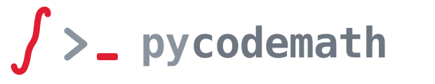

<p align="center">
  
</p>

<p align="center">
  <strong>Twój kod wygląda dobrze. A matematyka?</strong>
</p>

**Pycodemath sprawdza matematykę w twoim kodzie Pythona.** Podajesz funkcję i
wzór, który ma liczyć. Dostajesz dowód, że się zgadzają, albo dokładne wejście,
które funkcję psuje. Bez zgadywania, bez losowych próbek.

```bash
pip install pycodemath
```

```python
# example.py
from pycodemath import check_code

SRC = '''
def sum_to(n: int) -> int:      # ma zwracać 0 + 1 + ... + n
    total = 0
    for k in range(n):          # błąd o jeden: kończy na n-1
        total += k
    return total
'''

if __name__ == "__main__":      # wymagane na Windowsie: funkcja działa w osobnym procesie
    r = check_code(SRC, "n*(n+1)/2")
    print(r.verdict)               # refuted
    print(r.counterexample.call)   # sum_to(n=1)
    print(r.reason)                # sum_to(n=1) returns 0, the formula gives 1 ...
```

`REFUTED` zawsze niesie konkretne wejście, które naprawdę wykonano (*świadek*).
`VERIFIED` to dowód. Wszystko inne to `UNDECIDED` z powodem. Popraw pętlę na
`range(n + 1)`, powiedz, że `n` to nieujemna liczba całkowita
(`domain={"n": "integer, n>=0"}`), a to samo wywołanie zwróci `VERIFIED`.

Pycodemath to też dokładny silnik matematyczny i serwer MCP dla agentów AI
(SymPy + NumPy): zapisujesz matematykę w kilku znakach, a dostajesz dokładny
wynik albo samodzielny, zoptymalizowany kod Python/NumPy, zamiast prosić model
językowy, żeby „policzył w pamięci".

*English version of this document: [README.md](README.md).*

**Spis treści:**
[Sprawdź matematykę w swoim kodzie](#sprawdź-matematykę-w-swoim-kodzie) ·
[Instalacja](#instalacja) ·
[Szybki start](#szybki-start) ·
[Weryfikacja](#weryfikacja-sprawdź-zamiast-policz) ·
[Wyniki, po których można się rozgałęzić](#wyniki-po-których-można-się-rozgałęzić) ·
[Generowanie kodu](#generowanie-kodu) ·
[Kontrakty projektowe](#kontrakty-projektowe)

## Co to robi

Cienka, zdyscyplinowana warstwa nad SymPy + NumPy:

1. **Cięcie tokenów** — jedna krótka komenda, jeden dokładny wynik. Gotowe
   narzędzie dla agenta (serwer MCP w zestawie).
2. **Lepszy kod niż naiwny Python** — generator robi uproszczenie symboliczne
   + eliminację powtórzonych podwyrażeń (CSE), zanim wyemituje kod (zmierzone
   ~1,7× szybciej niż naiwne rozpisanie przy powtarzających się
   podwyrażeniach).
3. **Wyniki, po których można się rozgałęzić** — porażka jest TYPEM, nie
   komunikatem, a wynik numeryczny potrafi oddać dowód, na którym stoi. Patrz
   [Wyniki, po których można się rozgałęzić](#wyniki-po-których-można-się-rozgałęzić).
4. **Sprawdź zamiast policz** — tożsamość, wyprowadzenie krok po kroku albo
   odpowiedź silnika, oceniane VERIFIED / REFUTED (z kontrprzykładem) /
   UNDECIDED. Patrz [Weryfikacja](#weryfikacja-sprawdź-zamiast-policz).
5. **Sprawdź matematykę w swoim kodzie** — funkcję wobec jej wzoru, dokładność
   floatów, przepełnienia, pieniądze, jednostki i geometrię, każde ze świadkiem
   albo dowodem. Patrz [Sprawdź matematykę w swoim kodzie](#sprawdź-matematykę-w-swoim-kodzie).

```
tekst → [parser] → IR (drzewo wyrażeń) → [silnik]     liczy / upraszcza / rozwiązuje
                                       → [generator]  IR → CSE → kod Python/NumPy
```

Kamień węgielny: **wspólne IR** (`pycodemath/core/ir.py`) — kontrakt między
silnikiem a generatorem.

## Sprawdź matematykę w swoim kodzie

Kod, który liczy wzór, można sprawdzić jak tożsamość. Pycodemath czyta funkcję
Pythona i dowodzi, że jest równa wzorowi, który ma liczyć — albo oddaje
**dokładne wywołanie, które ją psuje**, naprawdę wykonane, nigdy „nie zgodziło
się na jakichś losowych próbkach". Przez wszystkie sprawdzenia niżej biegnie ten
sam kontrakt: **VERIFIED** to dowód, **REFUTED** zawsze niesie konkretnego
świadka sprawdzonego dokładnie, a wszystko inne to **UNDECIDED** z powodem. Każda
odpowiedź kończy się linią `certificate:` — sprawdzeniem zapisanym tak, że da się
je powtórzyć z samego pliku (patrz
[Certyfikaty](#certyfikaty-sprawdzenie-które-każdy-może-powtórzyć)).

**Czy ta funkcja liczy ten wzór?** Klasyczny błąd o jeden:

```pycon
>>> from pycodemath import check_code, emit_test
>>> src = "def sum_to(n: int) -> int:\n    total = 0\n    for k in range(n):\n        total += k\n    return total\n"
>>> r = check_code(src, "n*(n+1)/2")
>>> r.verdict, r.counterexample.call
('refuted', 'sum_to(n=1)')
>>> r.reason
'sum_to(n=1) returns 0, the formula gives 1 — confirmed by executing the function and evaluating the formula exactly'
>>> check_code(src, "n*(n-1)/2", domain={"n": "integer, n>=0"}).verdict
'verified'
>>> "assert sum_to(n=1) == 1" in emit_test(r, module="sums")
True
```

Poprawny kod wraca jako VERIFIED z dowodem (symbolicznym, gałąź po gałęzi albo
dokładnym certyfikatem dla kodu całkowitoliczbowego z `//` i `%`). Samo
zaokrąglenie floatów nigdy nie jest tu błędem — od tego jest `stability`.
`emit_test` pisze test pytest, który przypina kontrprzykład. Z powłoki, na
własnym pliku (funkcja jest wykonywana w izolowanym procesie, żeby potwierdzić
obalenie):

```bash
python -m pycodemath "verify code sums.py:sum_to == n*(n+1)/2 --emit-test"
python -m pycodemath "verify code sums.py:sum_to == n*(n-1)/2 where n: integer, n>=0"
```

**Dokładność zmiennoprzecinkowa, z dowodem.** Ile bitów traci float64, gdzie i
dlaczego — oraz przepisanie **udowodnione jako równe** i **zmierzone** jako
lepsze:

```console
$ python -m pycodemath "stability sqrt(x + 1) - sqrt(x) for x in [1e10, 1e15]"
sqrt(x + 1) - sqrt(x) [float64]: loses 41.0 bits on average (max 49.9); worst at {'x': '510800533960562.3'}
  worst: at x = 510800533960562.3 computes 1.862645149230957e-08, exact 2.2123015980434279398e-8 (49.9 bits)
  culprit: sqrt(x + 1) - sqrt(x) — cancellation: subtracting nearly equal values (41.0 bits on average); try p - sqrt(q) -> (p^2 - q) / (p + sqrt(q)) (conjugate)
certificate: REFUTED (re-evaluation) — at x = 510800533960562.3: float64 computes 1.862645149230957e-08 (emitted NumPy code), exact 2.2123015980434279398E-8 (SymPy, 40 digits): 49.9 bits lost (more than 3)
```

```pycon
>>> from pycodemath import diagnose, improve
>>> rep = diagnose("sqrt(x + 1) - sqrt(x)", {"x": (1e10, 1e15)})
>>> round(rep.mean_bits, 1), rep.culprits[0].cause
(41.0, 'cancellation: subtracting nearly equal values')
>>> imp = improve("sqrt(x + 1) - sqrt(x)", {"x": (1e10, 1e15)})
>>> imp.best.expression, imp.best.proof.status, round(imp.best.mean_bits, 1)
('1 / (sqrt(x + 1) + sqrt(x))', 'verified', 0.4)
```

`improve ... emit python|numpy|c` wypisuje kod liczący dokładnie to, co zostało
zmierzone. Żadne przepisanie nie wraca bez dowodu. W porównaniu z Herbie na 11
benchmarkach Hamminga, których optymalizator nie oglądał przy strojeniu: 7,25 bitu błędu
po przepisaniu wobec 8,08 dla wyników Herbie (lepiej w 3, gorzej w 5, remis w 3)
— względem opublikowanego raportu Herbie z 2017 r. (era 1.1), nie dzisiejszego
Herbie 2.x, którego nie dało się zainstalować w środowisku pomiaru.

**Czy to się przepełni?** Błąd wyszukiwania binarnego z 2006 r., z wejściem,
które go wywołuje (wykonanym w NumPy int32), i poprawką z dowodem
równoważności:

```console
$ python -m pycodemath "ranges (lo + hi) // 2 for lo in [0, 2^31-1], hi in [0, 2^31-1] as int32"
(lo + hi) // 2  [int32]  -> problems
  confirmed overflow                   lo + hi at {'hi': '2147483647', 'lo': '2147483647'} -> -2
  advice: lo + (hi - lo) // 2 [int32] removes overflow
  advice: (lo + hi) // 2 [int64] removes overflow
  advice proof: lo + (hi - lo) // 2 — verified (symbolic (integer parity cases))
  advice proof: (lo + hi) // 2 — verified (same expression)
certificate: REFUTED (execution) — overflow at lo + hi: lo + hi at hi=2147483647, lo=2147483647: got -2, exact 4294967294

$ python -m pycodemath "maxsafe exp(x) for x as float32"
x <= 88.72283172607422 is safe in float32 (exact bound 11629079/131072; interval/exhaustive proof below, executed witness above)
  first failure: exp(x) at x=88.72283935546875: got inf, exact 3.4028244988034356558e+38
  x <= 88.72283172607422 is proved safe; x = 88.72283935546875 fails (overflow at exp(x))
certificate: VERIFIED (proof) — no event in float32 over the given ranges
```

int8…uint64, float16, bfloat16, float32, float64: przepełnienie, niedomiar,
liczby subnormalne, NaN, dzielenie przez zero, utrata precyzji całkowitej
(`for t_ms in [0, 2^31-1] int as float32` — znaczniki czasu w milisekundach we
float32). „Bezpieczne" to dowód, nie zgadywanie. W Pythonie:
`pycodemath.code.analyze(expr, ranges, dtype)` i `max_safe_input`.

### Kalkulator, który dowodzi swoich odpowiedzi

```console
$ python -m pycodemath "factor 2^64+1"
274177 * 67280421310721
certificate: VERIFIED (proof) — product of the factors equals 18446744073709551617 exactly; each factor is proven prime; re-multiplied: the factors give the number back

$ python -m pycodemath "special zeta 3 digits 50"
1.2020569031595942853997381615114499907649862923405
certificate: VERIFIED (cross-check) — precision ladder: values at 65 and 130 digits agree; Euler-Maclaurin summation agrees with the default (Borwein) algorithm

$ python -m pycodemath "var sample 1 2 3 4"
5/3
certificate: VERIFIED (proof) — exact rational sample variance over a common denominator
```

Pierwszość jest udowodniona (deterministyczny Miller–Rabin poniżej 3,3·10²⁴,
Lucas–Lehmer albo sprawdzalny certyfikat Pocklingtona powyżej; to, co jest
tylko BPSW-prawdopodobne, jest UNDECIDED i tak to nazywa). Teoria liczb,
kombinatoryka, 13 funkcji specjalnych z dowolną precyzją, dokładne statystyki
opisowe, 7 rozkładów i zestaw do testów A/B (`samplesize`, `power`,
`ci wilson|exact`, `ztest`, `welch`, `holm`), którego odpowiedzi zawsze niosą
ostrzeżenia o podglądaniu wyników i wielokrotnych porównaniach. W Pythonie:
`pycodemath.calc` i `pycodemath.stats`.

### Jednostki i wymiary

```console
$ python -m pycodemath "5 km/h to m/s"
25/18 m/s ≈ 1.38888888888889 m/s
certificate: VERIFIED (exact-conversion) — 5 km/h = 25/18 m/s ≈ 1.38888888888889 m/s (dimension ratio 1, exact round trip; sympy.physics.units agrees: True)

$ python -m pycodemath "units F = m*v where F:N m:kg v:m/s"
REFUTED (dimensional-analysis) — left is kg·m/s² (force), right is kg·m/s (momentum)
  left: kg·m/s²; right: kg·m/s
certificate: REFUTED (dimensional-analysis) — left is kg·m/s² (force), right is kg·m/s (momentum)
```

Jednostki to sygnał weryfikacji, nie tylko przelicznik: `check_dimensions("F",
"m*v", {"F": "N", "m": "kg", "v": "m/s"})` jest obalone ze świadkiem. Absolutne
°C/°F nigdy nie są cicho skalowane, `KB`, `month`, `dB` są odrzucane jako
dwuznaczne, a `rad/s` to nie `Hz`. W Pythonie: `pycodemath.convert`,
`check_dimensions`, `dimension_of`, `pycodemath.units`.

### Pieniądze: żaden grosz nie ginie

```console
$ python -m pycodemath "money split 100 PLN into 3"
33.34 + 33.33 + 33.33 = 100.00 PLN  (hamilton; sums exactly: True)
certificate: VERIFIED (exact) — shares sum to the total exactly (rational sum); zero weights get zero; every share within one unit of its quota; equal split: spread <= one unit; shares re-added in exact fractions

$ python -m pycodemath "money float round(x*1.23, 2) for x in 0.01..50.00 currency PLN"
float gives 0.61 where exact decimal arithmetic gives 0.62; e.g. the literal 1.23 is stored as 1.229999999999999982236431605997495353221893310546875
  witness: at x = 0.50 floats give 0.61, exact 0.62 (22 of 5000 inputs wrong)
certificate: REFUTED (execution) — float gives 0.61 where exact decimal arithmetic gives 0.62; e.g. the literal 1.23 is stored as 1.229999999999999982236431605997495353221893310546875

$ python -m pycodemath "money irr -100,230,-132"
IRR: 10%, 20% (2 rates — the IRR is not unique; exact brackets [['1/10', '1/10'], ['1/5', '1/5']])
certificate: VERIFIED (exact) — sign change (or exact zero) of the square-free factor on every bracket; root count == Sturm count on (0, inf); Descartes' rule of signs: bound and parity; each rate within 10^-12 of the true root
```

Do tego `money round` (8 nazwanych trybów, kroki gotówkowe), `money vat` (od
pozycji a od sumy, z udowodnionym najgorszym przypadkiem), `money interest`,
`money loan` (ostatnia rata koryguje zaokrąglenia) i `money npv`. W środku
żadnych floatów: dokładne ułamki, `Decimal` w skali waluty według ISO 4217. W
Pythonie: `allocate`, `round_money`, `float_money_hazard`, `pycodemath.money`.

### Geometria i grafika

```console
$ python -m pycodemath "rotcheck q1*q2 == R2@R1"
REFUTED (exact-witness) — the two sides differ at 1 = (1, 2, 3, 4) / sqrt(30), 2 = (2, -1, 1, 3) / sqrt(15)
  likely cause: multiplication order reversed (q1*q2 applies q2 FIRST; R1@R2 applies R2 first); row-vector (v@M) matrices read as column-vector (M@v) ones, or vice versa
certificate: REFUTED (exact-witness) — multiplication order reversed (q1*q2 applies q2 FIRST; R1@R2 applies R2 first); row-vector (v@M) matrices read as column-vector (M@v) ones, or vice versa

$ python -m pycodemath "epsilon orient2d 1e-9"
REFUTED — 2 witness(es), each re-executed in floats and decided exactly
  false_degenerate: input [[0.0, 0.0], [1.0, 0.0], [0.5, 4.656612873077393e-10]] — the epsilon test says collinear, exactly ccw
  wrong_sign: input [[128.00000000000117, 128.00000000000136], [3072.0, 3072.0], [6144.0, 6144.0]] — the epsilon test says cw, exactly ccw
certificate: REFUTED (exact-witness) — 2 witness(es), each re-executed in floats and decided exactly
```

Obroty bez ruletki konwencji (`quat2mat`, `euler2mat`, `mat2euler`, wszystkie
24 konwencje Eulera), predykaty, które nie kłamią (`orient2d`, `orient3d`,
`incircle`: filtr Shewchuka z dokładnym zapasem), CSS `easing` z udowodnionym
przedziałem, długość krzywej Béziera (`arclength`) ze ścisłym oszacowaniem i
`emit` każdego wzoru jako Python, NumPy, C i GLSL, wykonany wobec
certyfikowanej implementacji. W Pythonie: `compare_rotation_expressions`,
`orient2d`, `pycodemath.geometry`.

### Liczby, którym można ufać

Dokładna odpowiedź przychodzi ze swoim rozwinięciem dziesiętnym, a to
rozwinięcie jest **udowodnione**: każda wypisana cyfra to poprawnie zaokrąglona
wartość, rozstrzygnięta arytmetyką przedziałową (`sqrt(2)/2  ≈
0.707106781186548`). `evalf <wyrażenie> <cyfry>` i `N(<wyrażenie>, <d>)` proszą o
więcej cyfr; `identify` rozpoznaje stałą tylko wtedy, gdy cyfr jest dość, by
wykluczyć przypadek:

```console
$ python -m pycodemath "evalf exp(pi*sqrt(163)) - 640320^3 - 744 15"
≈ -7.49927402801814e-13
  15 digits, interval (rigorous)
certificate: VERIFIED (interval) — rigorous interval enclosure at 178 bits rounds to the same 15 digits at both ends

$ python -m pycodemath "identify 1.6449340668482264"
1.6449340668482264: UNDECIDED — best candidate pi**2/6 is consistent with the 17 digits given, but 17 < 50 digits cannot exclude a coincidence
  candidate pi**2/6  (deviation -3.65e-17, agrees on 16 digits, margin 11.5)
  warning: only 17 significant digits: the 150 families searched hold far more than 10^17 formulas with small coefficients, so a match to 17 digits happens by chance (the 'strong law of small numbers' — numerology); give at least 50 digits to recognise a constant
certificate: UNDECIDED (pslq+enclosure) — best candidate pi**2/6 is consistent with the 17 digits given, but 17 < 50 digits cannot exclude a coincidence
```

Tam, gdzie ścisłej obudowy nie ma (`besselj`, `zeta` niecałkowitej), cyfry są
zgodnością dwóch precyzji i mówią to — `rigorous: false`, certyfikat UNDECIDED,
nigdy VERIFIED:

```pycon
>>> from pycodemath import approx, identify
>>> a = approx("besselj(0, 1)")
>>> a.value, a.method, a.rigorous
('0.765197686557967', 'stable-doubling', False)
>>> identify("zeta(2)").value
'pi**2/6'
```

Zmierzone: `sympy.nsimplify` „rozpoznaje” 60 z 60 losowych liczb
16-cyfrowych; `identify` — 0 z tych samych 60. W Pythonie: `approx`, `evalf_to`,
`dual`, `identify`.

### Nierówności, układy, całki oznaczone — każda odpowiedź z dowodem

Prosta rzeczywista jest cięta w każdym zerze i na każdej granicy dziedziny,
każdy punkt cięcia rozstrzygnięty dokładnie (należy albo nie), a każda otwarta
komórka ma udowodniony stały znak. Układ przychodzi z argumentem kompletności;
całka przez biegun jest rozpoznana jako rozbieżna, a nie przeskoczona
(`[-1/x] = -2` jest tu niemożliwe); zbieżna jest zwracana tylko wtedy, gdy jej
postać zamknięta zgadza się z niezależną kwadraturą wysokiej precyzji, a ta bez
postaci zamkniętej odpowiada *zbieżna, wartość ≈ …*:

```console
$ python -m pycodemath "solve x^2 - 3x + 2 < 0"
x ∈ (1, 2)
  proof: sign decomposition (exact-roots) — 3 cells, 2 endpoints decided exactly
certificate: VERIFIED (exact-roots) — sign decomposition (exact-roots): 3 cells, 2 endpoints decided exactly

$ python -m pycodemath "solve x + y = 3, x - y = 1 for x, y"
x = 2, y = 1
  proof: rank(A) = rank([A|b]) = 2; the solution set is an affine space of dimension 0 = n - rank, and the substituted family satisfies every equation identically in its 0 parameter(s)
certificate: VERIFIED (linear) — rank(A) = rank([A|b]) = 2; the solution set is an affine space of dimension 0 = n - rank, and the substituted family satisfies every equation identically in its 0 parameter(s)

$ python -m pycodemath "integrate 1/x^2 dx from -1 to 1"
diverges to oo
  singular points inside: 0
  the integral diverges to +oo by the limit comparison test — at 0-: lim t·f = oo (nonzero); at 0+: lim t·f = oo (nonzero)
certificate: VERIFIED (proof) — the integral diverges to +oo by the limit comparison test — at 0-: lim t·f = oo (nonzero); at 0+: lim t·f = oo (nonzero)

$ python -m pycodemath "solve sin(x) = 1/2 all"
x = pi/6 + 2*pi*k, x = 5*pi/6 + 2*pi*k, k ∈ ℤ
  proof: period 2*pi (the two sides are identical after automatic simplification); solutions in one period complete (sign decomposition)
certificate: VERIFIED (interval-arithmetic) — period 2*pi proved (the two sides are identical after automatic simplification); the solutions in one period proved complete by sign decomposition
```

`reduce x^2 < 4 for x` czyta się tak samo; `for x in [0, 2*pi]` ogranicza
nierówność trygonometryczną; wartość główna Cauchy'ego tylko na życzenie (`pv`).
Na zestawie oceny (96 przypadków): 0 zweryfikowanych złych odpowiedzi, wobec 3 dla
surowego SymPy 1.14 i 5 dla Maximy 5.46. W Pythonie: `solve_inequality`,
`solve_system`, `periodic_solutions`, `definite_integral`.

### Ile razy wykona się ta pętla?

`count_iterations(f)` czyta pętle i zwraca dokładną liczbę iteracji, obszar, w
którym wzór obowiązuje, i Θ udowodnione granicą — a potem uruchamia funkcję i
liczy. `check_iterations(f, "n**2")` łapie błąd o jeden prawdziwym wywołaniem.
Rekurencje są rozwiązywane razem z warunkami: twierdzenie o rekurencji
uniwersalnej odmawia dla `2T(n/2) + n/log n` (luka między przypadkami 1 i 2), a
Akra–Bazzi odpowiada Θ(n log log n):

```console
$ python -m pycodemath "iterations tests/data/lint/dev/p504_zero_based_ok.py:sum_below == n + 1"
REFUTED (execution) — at n=0 the loop ran 0 times; the claim gives 1
  counted: n iterations
certificate: REFUTED (execution) — at n=0 the loop ran 0 times; the claim gives 1

$ python -m pycodemath "recurrence T(n) = 2*T(n/2) + n/log(n)"
Θ(n*log(log(n)))
  Akra–Bazzi: Θ(n*log(log(n))) by Akra–Bazzi (master theorem refused: master theorem does not apply: gap: f = Θ(n^1 log^-1 n) with k = -1 < 0 lies between case 1 and case 2)
  check: terms [('2', '1/2')]: a_i > 0, 0 < b_i < 1
  check: g(n) > 0 for all large n
  check: p = 1 solves sum a_i b_i^p = 1
  check: polynomial growth: lim n g'(n)/g(n) = 1 (finite), so g is regularly varying and g(u)/g(n) is bounded above and below for u in [b n, n]
  check: ∫_2^n g(u)/u^(p+1) du = log(log(n)) - log(log(2))
certificate: VERIFIED (Akra–Bazzi) — Θ(n*log(log(n))) by Akra–Bazzi (master theorem refused: master theorem does not apply: gap: f = Θ(n^1 log^-1 n) with k = -1 < 0 lies between case 1 and case 2)
```

```pycon
>>> from pycodemath import count_iterations, check_iterations
>>> src = "def pairs(n: int) -> int:\n    c = 0\n    for i in range(n):\n        for j in range(i):\n            c += 1\n    return c\n"
>>> r = count_iterations(src)
>>> str(r.main), r.valid_for, str(r.theta), r.certificate.points, r.certificate.agree
('n*(n - 1)/2', 'n >= 1', 'n**2', 39, True)
>>> check_iterations(src, "n**2/2").reason
'at n=1 the loop ran 0 times; the claim gives 1/2'
```

Także `complexity f.py:f is O(n log n)` (O, Theta, Omega, o, omega —
rozstrzygane granicą) i `master <a> <b> <f>`. Na zestawie oceny: `rsolve` z SymPy
daje postać zamkniętą dla 5 z 20 rekurencji i odmawia każdej typu „dziel i
rządź”; empiryczny pakiet `big_O` trafia klasę dla 10 z 17 pętli (te
same przypadki). CLI uruchamia TWÓJ plik; przez MCP (`math_iterations`) nic się
nie wykonuje, dopóki agent nie poda `execute=true`.

### Sprawdź matematykę w całym repo

`python -m pycodemath.lint src/` (albo skrypt `pycodemath-lint`) znajduje
miejsca, w których matematyka w kodzie liczy złą wartość — wzory
zmiennoprzecinkowe tracące precyzję, przepełnienie całkowite dla zadeklarowanego
typu NumPy, `round()` i binarne floaty na pieniądzach, `==` na floatach, `^`
użyte jako potęga, `range` przesunięty o jeden względem wzoru `:math:` funkcji.
**Każde zgłoszenie niesie świadka**: konkretne wejście, które zostało wykonane, i
dokładną wartość, jaką powinno dać, policzoną niezależnie. Gdzie istnieje
poprawka, jest udowodniona.

```console
$ python -m pycodemath "lint tests/data/lint/dev/p401_gross.py --concise --no-cache"
p401_gross.py:3:12: PCM401 binary floats change this amount: round(price * 1.23, 2) at price=0.50 = 0.61, exact 0.62 — use Decimal
p401_gross.py:3:12: PCM503 round() is half-to-even: round(price * 1.23, 2) at price=1.50 = 1.84, exact 1.85 with HALF_UP
Found 2 findings in 1 file.
certificate: REFUTED (witness) — PCM401 line 3: binary floats change this amount: round(price * 1.23, 2) at price=0.50 = 0.61, exact 0.62 — use Decimal (+1 more)
```

Kody wyjścia jak w ruff (0 czysto, 1 zgłoszenia, 2 błąd — tylko dla `lint`).
Reguły: `--list-rules`, `--explain PCM401`. SARIF dla GitHub code scanning:
`--format sarif` (przykładowy workflow w `examples/github-action/pcm-lint.yml`).
pre-commit: hook `pycodemath-lint`. pytest: `pytest --pcm` sprawdza każde
`:math:` / `@spec` jako test (instalowany jako wtyczka, która bez flagi nic nie
robi). Na zbiorze wstrzymanym lintera: 13 z 13 oczekiwanych zgłoszeń, 0 fałszywych.
W Pythonie: `lint_source`, `lint_paths`, `spec`, `LintConfig`.

### Dla agentów: sześć kolejnych narzędzi MCP

`math_eval` odpowiada na każdą linię powyżej (jego odpowiedź zyskuje pola
`result` — własny obiekt wyniku modułu — i `certificate`). Pięć typowanych
narzędzi przyjmuje to, co nie mieści się w jednej linii: `math_check_code`
(źródło funkcji; **domyślnie kod jest tylko czytany i dowodzony, nigdy
uruchamiany** — obalenie, które wymaga uruchomienia, zostaje UNDECIDED, dopóki
agent nie poda `execute=true`), `math_iterations` i `math_lint` (też źródło, ta
sama domyślna `execute=false`), `math_stability` i `math_ranges` (słownik
zakresów zmiennych). `math_recheck` powtarza dowolny certyfikat. Wszystkie sześć
odpowiada tymi samymi sześcioma polami: `text`, `kind`, `status`, `result`,
`certificate`, `error`.

## Instalacja

```bash
pip install -e .                  # rdzeń: sympy + numpy
pip install -e .[mcp]             # + serwer MCP dla agentów AI
pip install -e .[dev]             # + pytest
```

Wymaga Pythona ≥ 3.11. Pakiet niesie znacznik `py.typed`, więc wszystko poniżej
jest w pełni otypowane także dla ZAINSTALOWANEGO wołającego — łącznie z
przeciążeniami, przez które `full_result=True` zmienia typ zwracany. Nigdzie
żadnego `cast()`.

## Szybki start

### Jednorazowe wywołanie z linii poleceń

Każda komenda niżej to prawdziwe wywołanie z prawdziwym wyjściem.

```console
$ python -m pycodemath "diff sin(x)*x dx"
x*cos(x) + sin(x)

$ python -m pycodemath "solve x^2 - 4 for x"
-2, 2

$ python -m pycodemath "sin(x)^2 + cos(x)^2"
1

$ python -m pycodemath "eig [[2,1],[1,2]]"
3, 1

$ python -m pycodemath "solve_nd x^2+y^2-4; x-y for x,y at 1,1"
x = 1.4142135623746899, y = 1.4142135623746899
```

Błędy idą na stderr z kodem wyjścia 1, wyniki na stdout z kodem 0 — bezpiecznie
wołać ze skryptów i narzędzi agenta. Na konsoli Windows ustaw `PYTHONUTF8=1`.

### REPL

```bash
python -m pycodemath          # albo po prostu: pycodemath
pytest                        # testy
python -m pycodemath.bench.benchmark   # dowód: CSE bije naiwny kod
```

`help` wypisuje pełną tabelę komend (pochodne, całki, rozwiązywanie równań,
macierze, szukanie pierwiastków, optymalizacja, cały pakiet ODE, generowanie
kodu i wszystkie sprawdzenia z [Sprawdź matematykę w swoim kodzie](#sprawdź-matematykę-w-swoim-kodzie)).
Nazwy są czytane ściśle: `speed*time` ma dwie zmienne, nigdy dziesięć liter;
nieznane słowo-polecenie jest odrzucane z podpowiedzią „did you mean". W REPL
`implicit on` rozbija wieloliterowe nazwy na litery (`2xy` = `2*x*y`), a
`implicit off` przywraca domyślny tryb; certyfikat zapisuje, w którym trybie
odczytano jego twierdzenie.

### Serwer MCP — Pycodemath dla agentów

Każdy agent AI z klientem MCP może liczyć przez Pycodemath (to samo API co
REPL, jedna komenda = jeden dokładny wynik — realizacja celu „cięcie tokenów"):

```bash
pip install -e .[mcp]
claude mcp add pycodemath -- python -m pycodemath.cli.mcp_server
```

Serwer wystawia `math_eval`. To, co ODSYŁA, jest
[odpowiedzią strukturalną](#od-strony-agenta-odpowiedź-mcp), nie samą prozą.
Jego bliźniak, `math_verify`, SPRAWDZA zamiast liczyć — tożsamość,
wyprowadzenie albo odpowiedź silnika — patrz
[Weryfikacja](#weryfikacja-sprawdź-zamiast-policz).
Cztery kolejne narzędzia sprawdzają kod i certyfikaty: `math_check_code`,
`math_stability`, `math_ranges`, `math_recheck` — patrz
[Dla agentów](#dla-agentów-sześć-kolejnych-narzędzi-mcp).

## Wyniki, po których można się rozgałęzić

Wynik numeryczny to nie tylko liczba. Jest różnica między pierwiastkiem pewnym
a takim, który wcisnął się w tolerancję na ostatniej dozwolonej iteracji;
między całką dokładną a jedynie ZAKOŃCZONĄ. Pycodemath pozwala o to zapytać —
i ma na to typy.

### Porażka jest typem, nie komunikatem

Wszystko, czego biblioteka odmawia, rzuca podklasę `PycodemathError`, więc
wołający rozgałęzia się po KLASIE zamiast dopasowywać wzorce do tekstu:

| wyjątek | co się stało | kiedy |
| --- | --- | --- |
| `ParseError` | tekst odrzucony, zanim zaczęła się matematyka | zła składnia, niespójna macierz |
| `DomainError` | zła wartość, kształt, opcja albo punkt | `n <= 0`, nieznana metoda, próbka poza dziedziną |
| `DivergenceError` | iterat uciekł | funkcja nieograniczona z dołu, brak pierwiastka w tym kierunku |
| `StagnationError` | bieg przestał robić postęp | krok zapadł się do zera, wartość stanęła |
| `NonConvergenceError` | skończył się limit iteracji | `max_iter` osiągnięte przy wciąż dużym residuum |
| `NotAMinimumError` | bieg DOSZEDŁ — do złego rodzaju punktu | start na maksimum, siodle albo przegięciu |
| `BudgetExhaustedError` | skończył się TWÓJ budżet ewaluacji, nie matematyka | `max_evals` osiągnięte w trakcie rafinowania całki |
| `TimeBudgetError` | skończył się TWÓJ zegar, i to bez niczego w ręku | SymPy wciąż liczy po 120 s wywołania symbolicznego |
| `NoClosedFormError` | silnik SZUKAŁ i nie znalazł formy zamkniętej | `integrate exp(sin(x)) dx`, suma nieskończona, `dsolve y' = t²+y²` |
| `UnsupportedFormError` | silnik nie ma METODY na ten kształt — nie zaczął szukać | `solve exp(x)+x^5-3 for x` miesza `x` z `exp(x)` |

Dwa pierwsze to odmowy WEJŚCIA, reszta to wyniki BIEGU. Ta linia jest
istotna — dokładnie ją rysują też wyniki strukturalne i payload MCP niżej.

```pycon
>>> from pycodemath import parse, minimize, DivergenceError
>>> try:
...     minimize(parse("-x^2"), "x", 1.0)
... except DivergenceError:
...     print("nieograniczona z dołu — nie ma czego szukać")
nieograniczona z dołu — nie ma czego szukać
```

Komunikaty nazywają wartość, która zawiniła, i mówią, co zrobić dalej — więc
proza jest warta czytania, kiedy czyta ją człowiek:

```pycon
>>> minimize(parse("-x^2"), "x", 1.0, method="sgd")
DomainError: minimize: unknown method 'sgd' — available: gd, newton, bfgs
```

### `full_result=True` — dowód, na którym stoi odpowiedź

`root_find`, `minimize`, `root_find_nd` i `minimize_nd` domyślnie zwracają gołą
liczbę. Poproś o pełny wynik, a dostaniesz `SolveResult`: tę samą wartość plus
to, co wiedziała pętla.

```pycon
>>> from pycodemath import root_find
>>> root_find(parse("x^2 - 2"), "x", 1.0)
1.4142135623746899
>>> root_find(parse("x^2 - 2"), "x", 1.0, full_result=True)
SolveResult(value=1.4142135623746899, iterations=5, residual=4.510614104447086e-12, converged=True, status='converged')
```

`residual` mówi, jak daleko od rozwiązania jest ZWRÓCONY punkt (`|f(x)|` przy
szukaniu pierwiastka, `‖∇f(x)‖∞` przy minimalizacji), przeliczone W TYM
punkcie — a nie najmniejsza wartość napotkana po drodze.

Ciekawsza jest porażka. Pod `full_result=True` wynik iteracji jest ZWRACANY
jako dane zamiast rzucany: `value` to ostatni iterat — miejsce, w którym solwer
się poddał, nie odpowiedź — a `converged` jest jedynym polem do rozgałęziania.

```pycon
>>> minimize(parse("-x^2"), "x", 1.0, full_result=True)
SolveResult(value=1085298990978.309, iterations=152, residual=2170597981956.618, converged=False, status='diverged')
>>> minimize(parse("x^4"), "x", 1.0, lr=1.0, full_result=True)
SolveResult(value=1.0, iterations=9, residual=4.0, converged=False, status='stagnated')
```

`status` pochodzi z jednego słownika — `converged`, `diverged`, `stagnated`,
`not_converged`, `not_a_minimum` (do zaimportowania jako `SOLVE_STATUSES`) —
który odbija klasy
wyjątków wyżej, więc bieg melduje ten sam wynik niezależnie od tego, jak o
niego zapytasz.

Odmowa WEJŚCIA rzuca w OBIE strony. `DomainError` nie jest wynikiem iteracji:
nie ma ostatniego iteratu do oddania, a wymyślenie dla niej statusu byłoby
kłamstwem.

```pycon
>>> minimize(parse("-x^2"), "x", 1.0, method="sgd", full_result=True)
DomainError: minimize: unknown method 'sgd' — available: gd, newton, bfgs
```

`residual` równe `inf` znaczy „nie dało się zmierzyć" w ostatnim iteracie
nieudanego biegu — a nie „było ogromne".

### Co tak naprawdę twierdzi `converged`

`converged=True` znaczy, że wartość jest odpowiedzią **na pytanie, które zostało
zadane** — PIERWIASTKIEM dla szukania miejsc zerowych, MINIMUM dla minimalizacji.
Nie „odpalił się test wyjścia", bo to twierdzenie słabsze — a do modułu 8 serii
v0.3 te dwie rzeczy rozjeżdżały się w obie strony. Trzy linijki, każda do
powtórzenia:

```pycon
>>> minimize(parse("-x^2"), "x", 0.0, full_result=True)
SolveResult(value=0.0, iterations=1, residual=0.0, converged=False, status='not_a_minimum')
>>> from pycodemath import minimize_nd
>>> minimize_nd(parse("x^2 - y^2"), ["x", "y"], [0.0, 0.0], full_result=True)
SolveResult(value=[0.0, 0.0], iterations=1, residual=0.0, converged=False, status='not_a_minimum')
>>> root_find(parse("exp(x)"), "x", 0.0, full_result=True)
SolveResult(value=-100.0, iterations=100, residual=3.720075976020836e-44, converged=False, status='not_converged')
```

Dwie pierwsze linijki są całym powodem, dla którego istnieje `not_a_minimum`:
znikający gradient zachodzi w KAŻDYM punkcie stacjonarnym, więc maksimum i
siodło zdają test wyjścia dokładnie tak dobrze jak minimum. Zanim to zaczęło być
sprawdzane, oba wracały z `converged=True`. Teraz, gdy test gradientu się odpali,
solver sonduje `f` wokół punktu i uznaje go za obalony wyłącznie wtedy, gdy
ZNAJDZIE obok ściśle niższą wartość — czyli po definicji „to nie jest minimum", a
nie po znaku krzywizny. Ta różnica jest jedynym powodem, dla którego `x^4` w 0
(minimum) i `-x^4` w 0 (maksimum) w ogóle da się rozróżnić: oba mają `f'' = 0`,
więc żaden test drugiego rzędu ich nie rozdzieli, a pierwsze nadal przechodzi:

```pycon
>>> minimize(parse("x^4"), "x", 0.0)
0.0
```

Trzecia linijka to drugi kierunek i zarazem powód, dla którego `residual` nie
zastępuje `converged`: `exp(x) = 0` nie ma pierwiastka, a iterat po prostu szedł
w lewo, aż funkcja OPADŁA poniżej tolerancji. Odrzucony bieg potrafi nieść
residuum rzędu `3.7e-44`. Odrzucenie złej odpowiedzi znajduje przy okazji dobrą,
którą wcześniej się mijało — `exp(x) - 1e-11` pierwiastek MA, a bieg zatrzymywał
się 2,4 przed nim:

```pycon
>>> root_find(parse("exp(x) - 1e-11"), "x", 0.0)
-25.32843600828441
```

W drugą stronę `converged=True` też nie wymaga, żeby residuum zeszło pod `tol`.
Zwykły spadek gradientowy w pobliżu minimum rozróżnia `f` tylko do szumu
zaokrągleń float64, a to następuje, gdy `‖∇f‖` jest jeszcze rzędu `1e-8`;
wartość jest poprawna do ośmiu cyfr znaczących, więc meldowanie tego jako
utknięcia — a tak było — było fałszywym alarmem:

```pycon
>>> minimize(parse("sin(x)"), "x", 0.0, full_result=True)
SolveResult(value=-1.5707963180031523, iterations=183, residual=8.791744282758072e-09, converged=True, status='converged')
```

`not_a_minimum` to jedyny status, którego NIE należy ponawiać z większym
`max_iter`. Bieg nie miał żadnego kłopotu ze zbieżnością i więcej iteracji nic
nie da: krok w punkcie stacjonarnym jest zerowy, więc iterat nie ruszy się choćby
i nigdy. Trzeba wystartować z innego punktu — obok tamtego.

Jedno uczciwe ograniczenie: nieznalezienie niższej wartości nie jest DOWODEM
minimalności. Sonda jest skończona — zestaw kierunków w zestawie odległości — a
funkcja potrafi schować spadek między dwiema próbkami. To dokładnie ten sam
status poznawczy, jaki test gradientu miał zawsze, tyle że ściśle mocniejszy:
wszystko, co było akceptowane wcześniej, jest akceptowane nadal — minus to, co
da się realnie obalić.

### Kwadratura ma własny typ wyniku

`integrate_num` zwraca `QuadratureResult`, a nie `SolveResult`, i ta różnica
jest świadoma: residuum solwera jest MIERZONE w zwróconym punkcie, a
`error_estimate` całki jest WYWNIOSKOWANE z dwóch siatek pod założeniem
gładkości, które integrand może złamać. Jedno pole nie uniesie uczciwie i
faktu, i domysłu naraz.

```pycon
>>> from pycodemath import integrate_num
>>> integrate_num(parse("sqrt(x)"), "x", 0.0, 1.0, full_result=True)
QuadratureResult(value=0.666585482066724, error_estimate=5.598027019277178e-05, evaluations=201, refinements=0, converged=True, status='converged')
```

Podaj `tol`, a stała siatka staje się lokalnie adaptacyjna — panele są
zagęszczane tylko tam, gdzie integrand jest trudny. Na `√x` (czwarta pochodna
nieograniczona w zerze) to 1 005 ewaluacji przeciw 262 145 przy globalnym
połowieniu siatki i przeszło milionowi podprzedziałów przy stałej:

```pycon
>>> integrate_num(parse("sqrt(x)"), "x", 0.0, 1.0, tol=1e-10, full_result=True)
QuadratureResult(value=0.6666666666666469, error_estimate=2.4271240969151142e-11, evaluations=1005, refinements=201, converged=True, status='converged')
```

`max_evals` (domyślnie 100 000) to twój jawny budżet. Jego wyczerpanie rzuca
`BudgetExhaustedError` — i to NIE jest diagnoza integranda: wartość istniała,
rafinowanie wciąż się opłacało, skończyło się wyłącznie twoje pozwolenie. Dlatego
ma własną klasę.

**`error_estimate` to oszacowanie, nigdy granica.** Tam, gdzie założenie
gładkości pada, oszacowanie nie jest po prostu luźne — jest OPTYMISTYCZNE.
Tutaj każdy węzeł siatki i każdy węzeł jej połowienia trafia w maksimum
cosinusa, obie siatki zgadzają się dokładnie, oszacowanie wychodzi `0.0`, a
prawdziwa całka wynosi `0.0` przy zwróconym `1.0`:

```pycon
>>> integrate_num(parse("cos(16*pi*x)"), "x", 0.0, 1.0, 4, full_result=True)
QuadratureResult(value=1.0, error_estimate=0.0, evaluations=9, refinements=0, converged=True, status='converged')
```

`converged` na ścieżce stałej siatki też nie jest twierdzeniem o jakości — bez
`tol` nie zamówiono żadnej dokładności, więc nic nie mogło jej nie dowieźć.
Wąski gauss wraca z `converged=True`, myląc się o 19%; jakość mieszka w
`error_estimate`, które to zgłasza:

```pycon
>>> integrate_num(parse("exp(-10000*x^2)"), "x", -1.0, 1.0, full_result=True)
QuadratureResult(value=0.014310170408337155, error_estimate=0.002575056679501588, evaluations=201, refinements=0, converged=True, status='converged')
```

### Od strony agenta: odpowiedź MCP

Narzędzie `math_eval` przenosi ten sam dowód przez granicę procesu, jako
`structuredContent` MCP. Cztery pola, zawsze obecne, `null` tam, gdzie nie
dotyczą:

```json
{"text": "...", "solve": {...}|null, "quadrature": {...}|null, "error": {...}|null}
```

* `text` — czytelna odpowiedź, bajt w bajt ta, którą wypisuje REPL. Na biegu
  niezbieżnym niesie zastrzeżenie, żeby klient renderujący sam tekst nie
  przeczytał ostatniego iteratu jako odpowiedzi.
* `solve` — `SolveResult` komend `root` / `min` / `solve_nd` / `min_nd`.
* `quadrature` — `QuadratureResult` komendy `nintegrate`.
* `error` — odmowa: `type` (NAZWA KLASY wyjątku), `message` oraz `route`
  (komenda zadająca to samo pytanie numerycznie, albo `null`).

Reguła dla agenta mieści się w jednym zdaniu: **rozgałęziaj po `error` (czy
odmówiono?) i po `converged` (czy wartość jest odpowiedzią?).** Wynik iteracji
to DANE, nie błąd. Ta sama komenda pokazuje obie połowy granicy:

```json
$ min -x^2 for x at 1
{"text": "1085298990978.309  (NOT CONVERGED — status diverged, residual 2.1706e+12 after 152 iterations)",
 "solve": {"value": 1085298990978.309, "iterations": 152, "residual": 2170597981956.618,
           "converged": false, "status": "diverged"}, "quadrature": null, "error": null}

$ min -x^2 for x at 1 method sgd
{"text": "error: minimize: unknown method 'sgd' — available: gd, newton, bfgs",
 "solve": null, "quadrature": null,
 "error": {"type": "DomainError", "message": "minimize: unknown method 'sgd' — available: gd, newton, bfgs",
           "route": null}}
```

`route` to jest to, co odmowa symboliczna niesie ZAMIAST wyniku strukturalnego.
Zamienia zdanie „policz numerycznie" w nazwę wywołania, które trzeba zrobić:

```json
$ integrate exp(sin(x)) dx
{"text": "error: integrate: no closed form — compute numerically or simplify the expression",
 "solve": null, "quadrature": null,
 "error": {"type": "NoClosedFormError",
           "message": "integrate: no closed form — compute numerically or simplify the expression",
           "route": "nintegrate"}}
```

`route` równe `null` samo w sobie niesie informację — znaczy, że ponowienie
numeryczne nie wchodzi w grę, więc trzeba zmienić pytanie.

Jednorazowe wywołanie z linii poleceń NIE ma flagi `--json`: wypisuje ten sam
czytelny tekst co REPL. Skrypt, który chce payloadu strukturalnego, woła
budowniczego wprost — to zwykły `dict`, niepotrzebny mu ani działający serwer,
ani dodatek `mcp`:

```pycon
>>> from pycodemath.cli.mcp_server import math_eval
>>> math_eval("root x^2-2 for x at 1")["solve"]["status"]
'converged'
>>> math_eval("det [[1,2],[3]]")["error"]["type"]
'ParseError'
```

Dwie rzeczy, które integrator powinien wiedzieć. `math.inf` jest w JSON-ie
niewyrażalne, więc niemierzalne `residual` albo `error_estimate` dociera jako
`null` — własne słowo JSON-a na „brak wartości". I: porażka jedzie jako dane
tylko tam, gdzie istnieje wynik strukturalny (cztery solwery + kwadratura); ODE,
symbolika, algebra liniowa i generowanie kodu nadal jadą jako `error`, ale z
nazwą klasy w `error.type`, czyli i tak w połowie maszynowo czytelnie.

### Czego te powierzchnie NIE obiecują

* `converged=True` na całce po stałej siatce znaczy, że o nic nie proszono — a
  nie, że wynik jest dobry. Czytaj `error_estimate`.
* `error_estimate` to oszacowanie. Potrafi wyjść 0.0 i być fałszem (wyżej).
* `max_evals` i `lr` zostają parametrami **wyłącznie API Pythona** — zmierzone
  jako niewarte wpisania do gramatyki (patrz [Opcje
  końcowe](#opcje-końcowe-tol-max_iter-budget) niżej). `tol` (na `min`,
  `min_nd`, `nintegrate`) i `max_iter` (na `min`, `min_nd`) DOCIERAJĄ do
  gramatyki REPL-a i MCP — bez nich każda całka nadal idzie ścieżką stałej
  siatki, więc `refinements` jest `0`, a `converged` jest `true`.

## Wywołanie symboliczne nie może wisieć w nieskończoność

Niektóre wejścia każą SymPy pracować bez końca. `integrate 1/(x^5+x+1) dx` nie
skończyło w 500 sekundach — i nie jest samo: `integrate log(x)/(x^5+x+1) dx`
oraz `series exp(sin(exp(x))) for x n 14` też nie kończą.

Goła SymPy też ich nie kończy — koszt jest odziedziczony, nie spowodowany tutaj.
Ale biblioteka, która daje agentowi wywołanie nigdy nie wracające, nie daje mu
niczego: żadnego wyniku, żadnego wyjątku, żadnego payloadu. Każda porażka w tej
serii jest typem, po którym można się rozgałęzić; ta jedna nigdy nie docierała.

Każde wejście symboliczne działa teraz pod budżetem zegara ściennego — domyślnie
**120 sekund** — i odmawia tym samym słownikiem, co wszystko inne:

```pycon
>>> from pycodemath import time_budget, symbolic, E
>>> with time_budget(0.5):
...     symbolic.integrate(E("1/(x^5+x+1)"), "x")
TimeBudgetError: integrate: gave up on 1/(x**5 + x + 1) after the 0.5s time budget — SymPy was still working and there is no partial result. This is NOT 'no closed form': an answer may well exist. Raise the budget (pycodemath.time_budget) or compute numerically.
```

`with time_budget(sekundy):` to sposób, żeby powiedzieć z góry, ile jesteś w
stanie czekać; zastępuje domyślny budżet dla wszystkiego, co wołasz w środku, a
`math.inf` wypisuje się z budżetów w ogóle. Budżet zagnieżdżony w innym nigdy go
nie przedłuża — wygrywa CIAŚNIEJSZY termin — więc wywołanie biblioteczne może
skrócić swój własny limit, ale nigdy nie wydłuży limitu wołającego.

### „Nie dałem mu dość czasu" to nie to samo, co „nie ma odpowiedzi"

Rozróżnienie, które moduł 8 wprowadził dla `converged`, obowiązuje tu wobec
czasu — i to jest powód, dla którego to OSOBNY wyjątek, a nie odgrzany stary:

```pycon
>>> symbolic.integrate(E("exp(sin(x))"), "x")
NoClosedFormError: integrate: no closed form — compute numerically or simplify the expression
```

Tamta odmowa jest faktem o **problemie** i pada w mocno poniżej sekundy.
`TimeBudgetError` jest faktem o **naszej cierpliwości** i nie twierdzi niczego o
tym, czy odpowiedź istnieje. Powtarzanie go bez zmian nic nie da — sięgnij po
`error.route` (niżej).

Świadomie nie jest to też `BudgetExhaustedError`, który zgłasza kwadratura po
wyczerpaniu `max_evals`. Tamten obiecuje coś, czego ten obiecać nie może: tam
bieg robi MIERZALNY postęp i powtórzenie z większym budżetem kończy robotę. Tu
nie ma częściowego wyniku, który dałoby się poprawić.

## Odmowa symboliczna mówi, co zrobić dalej — danymi

Silnik symboliczny był jedynym silnikiem bez żadnego strukturalnego dowodu.
Dziesięć instrukcji `raise PycodemathError(...)` — wszystkie na powierzchni
symbolicznej — niosło CZTERY różne wyniki matematyczne o CZTERECH różnych
lekarstwach pod jedną nazwą klasy. Agent, który chciał wiedzieć, czy **przestać**,
czy **spytać numerycznie**, musiał parsować angielski.

Naprawiają to dwie rzeczy i żadna z nich nie jest nowym typem wyniku — bieg
symboliczny nie ma iteratu, residuum ani częściowej wartości, więc nie byłoby
czym takiego typu wypełnić. Po pierwsze, klasa mówi teraz, jakiego RODZAJU jest
odmowa:

```pycon
>>> symbolic.integrate(E("exp(sin(x))"), "x")
NoClosedFormError: integrate: no closed form — compute numerically or simplify the expression
>>> symbolic.solve(E("exp(x)+x^5-3"), "x")
UnsupportedFormError: solve: no symbolic method for this equation in 'x' — find a numerical root instead (root <expr> for x at <x0>)
```

Pierwsza znaczy, że silnik przepuścił swoją metodę i wrócił z pustymi rękami —
czytaj ją jako granicę **zasięgu** tego silnika, a nie dowód, że odpowiedzi nie
ma. Druga znaczy, że metody na ten kształt nie ma w ogóle; własne słowa SymPy na
to (`multiple generators [x, exp(x)]`) siedzą teraz na `__cause__`, dla człowieka
przy debugowaniu, a nie w komunikacie, który dostaje agent.

Po drugie, każdy wyjątek niesie `route`: nazwę komendy zadającej to samo pytanie
numerycznie, albo `None`, gdy w tej gramatyce takiej komendy nie ma.

```pycon
>>> from pycodemath import NoClosedFormError, summation
>>> try:
...     symbolic.integrate(E("exp(sin(x))"), "x")
... except NoClosedFormError as exc:
...     print(exc.route)
nintegrate
>>> try:
...     summation(E("1/(k^2+k+1)"), "k", 1, "oo")
... except NoClosedFormError as exc:
...     print(exc.route)
None
```

Ta sama klasa, dwa różne następne ruchy: całka ma numeryczny odpowiednik pytania,
suma nieskończona nie ma żadnego — więc przy sumie nie ma czego spróbować i to
samo pytanie musi się zmienić. Właśnie po to jest `route`. `TimeBudgetError` też
ją niesie, wyprowadzoną z operacji, która przekroczyła budżet.

**Trasa jest faktem o API, nigdy obietnicą co do odpowiedzi.** Komenda sama w
sobie może się nie udać i może potrzebować danych, których wywołanie symboliczne
nie potrzebowało: `nintegrate` chce GRANIC, bo całka oznaczona to inne pytanie
niż funkcja pierwotna, a `root` chce punktu startowego.

### Jak wybrana została wartość domyślna

Zmierzone, na zimno, na jednej maszynie — i wnioskiem było, że **nie ma luki, w
którą można by celować**:

| klasa | najwolniejsze zmierzone |
| --- | --- |
| każdy przykład z README i jego sąsiedzi | 0,51 s |
| kończy się poprawną **odpowiedzią** | 14,7 s (`integrate 1/(x^9+x+1) dx`) |
| kończy się poprawną **odmową** | 14,5 s (`integrate exp(-x^2)*log(x)/(x^2+1) dx`) |
| nie kończy się | ∞ (`integrate 1/(x^5+x+1) dx`, wciąż liczy po 500 s) |

W obrębie jednej rodziny — `integrate 1/(x^n+x+1) dx` — koszt idzie 0,18 s,
0,23 s, 0,44 s, 14,7 s, a potem nie wraca w ogóle. Legalny ogon jest ciągły, a
porażka leży w nieskończoności, więc żaden próg nie oddziela pomiarowo „wolno"
od „nigdy".

**120 s myli się więc świadomie po stronie HOJNEJ**: 8× najwolniejsze poprawne
wywołanie i 235× najwolniejsze z szybkiej ścieżki. Wartość domyślna, która psuje
działające wywołanie, byłaby regresją; wartość, która odpala się wyłącznie na
pracy, na którą i tak nikt by nie czekał, kosztuje agenta dwie minuty, zanim
usłyszy, żeby spróbować inaczej.

### Czego strażnik NIE obiecuje

Przerwanie asynchroniczne dostarczane jest między dwoma bajtkodami, więc wątek
siedzący w jednym długim wywołaniu na poziomie C (wielka operacja na liczbach
całkowitych, skompilowane rozszerzenie) nie zauważy go, dopóki tamto nie wróci.
Każde zawieszenie zmierzone tutaj to czysto pythonowa SymPy i zostaje przerwane;
takie, które by nie było, przekroczyłoby swój budżet. Strażnik ogranicza tyle,
ile pozwala mu CPython.

Na **Pythonie 3.13** jest jeszcze jedno ograniczenie. CPython 3.13 (tylko on —
3.11, 3.12 i 3.14 działają poprawnie; gh-139622) pozwala wyjątkowi
asynchronicznemu pominąć wszystkie handlery ramki, w której wybucha. Strażnik
wstrzymuje się więc, dopóki przerwana ramka jest wewnątrz `try` / `with` /
`finally`, i przerywa dopiero tam, gdzie nic by nie przepadło. Wywołania silnika
są przerywane jak dotąd; pętla napisana wprost w Twoim bloku
`with time_budget(...)` dostaje odmowę, gdy się skończy, a nie w trakcie.

### Wersja twarda: `isolated`

Wywołanie, które musi skończyć się na czas bez względu na to, na co trafi,
uruchom w procesie roboczym:

```pycon
>>> from pycodemath import isolated, symbolic, E
>>> isolated(symbolic.integrate, E("x*sin(x)"), "x", budget=5.0)
Expr(-x*cos(x) + sin(x))
>>> isolated(pow, 7, 10**7, budget=1.0)
TimeBudgetError: pow: gave up on 7 after the 1s time budget — the call was stuck where the in-process guard cannot reach (one long C-level call), so its worker process was stopped and there is no partial result. This is NOT 'no closed form': an answer may well exist. Raise the budget or compute numerically.
```

Wywołanie biegnie pod tym samym strażnikiem w jednym, rozgrzanym procesie
roboczym; jeśli odpowiedź nie wróci do budżet + 0,5 s, proces zostaje zabity
i leci `TimeBudgetError`. Zmierzone na Windows / Pythonie 3.12: `7 ** (10**7)`
z budżetem 2 s trwało w procesie 7,9–8,7 s, a przez `isolated` dostało odmowę
po 2,52–2,53 s (5 na 5 przebiegów). Jest opcjonalne, bo kosztuje ok. +0,4 ms na
wywołanie (pickle i potok) oraz 1,2 s na jednorazowy start procesu — ponownie
tylko po zabiciu. Proces, który umrze bez odpowiedzi, to `IsolationError`,
nie budżet.

## Opcje końcowe: `tol`, `max_iter`, `budget`

API Pythona zawsze miało `tol` i `max_iter` na `minimize`/`minimize_nd`,
`tol` na `integrate_num` i `time_budget` dla silnika symbolicznego. Moduły
5–10 odraczały wpięcie ich do samej gramatyki komend, pięć osobnych razy.
Moduł 11 zamyka tę lukę na dowodzie, nie na symetrii: każda opcja niżej to
taka, która zmierzona ZMIENIA wynik; te pominięte zmierzone są jako takie,
które nie zmieniają.

To pary `klucz wartość` na KOŃCU komendy, w dowolnej kolejności, każda
najwyżej raz:

| opcja | komendy | co robi |
| --- | --- | --- |
| `tol <t>` | `min`, `min_nd` | akceptuj, gdy gradient spadnie poniżej `t` (domyślnie `1e-9`) |
| `tol <t>` | `nintegrate` | dopracowuj panele, aż szacowany błąd zmieści się w `t` — bez tego stała siatka jedzie bez zmian |
| `max_iter <k>` | `min`, `min_nd` | limit iteracji (domyślnie `10000`) |
| `budget <s>` | sześć komend symbolicznych | zastępuje domyślne 120 s na to JEDNO wywołanie |

```console
$ python -m pycodemath "min x^4 for x at 1 tol 1e-5"
0.029229144526165384
```

Bez `tol` to wywołanie nie zbiega — zmierzone: domyślne `tol=1e-9` potrzebuje
678 594 iteracji przy domyślnym limicie `max_iter=10000` spadku gradientowego,
więc rzuca `NonConvergenceError`, dopóki `max_iter` też nie zostanie
podniesiony. `tol 1e-5` dochodzi do akceptowalnego punktu w 1 456 iteracjach —
tu naprawia to LUŹNIEJSZY cel, nie większy budżet.

```console
$ python -m pycodemath "nintegrate sqrt(x) dx from 0 to 1 tol 1e-10"
0.6666666666666469
```

Bez `tol` stała siatka 100 paneli myli się o `8,1e-05` na `√x` (pochodna
eksploduje w 0 — dokładnie tam, gdzie kwadratura jest najsłabsza); celowanie
w `tol 1e-10` zbija prawdziwy błąd do `2e-14`, kosztem 1 005 ewaluacji zamiast
201 — czytaj to jako pole `error_estimate` zamienione z czytelnego na
działające.

`budget <s>` ogranicza to samo wywołanie, które w Pythonie ogranicza
`time_budget`, i cytuje je we własnej odmowie:

```json
$ integrate 1/(x^9+x+1) dx budget 0.3
{"text": "error: integrate: gave up on 1/(x**9 + x + 1) after the 0.3s time budget — SymPy was still working and there is no partial result. This is NOT 'no closed form': an answer may well exist. Raise the budget (pycodemath.time_budget) or compute numerically.",
 "solve": null, "quadrature": null,
 "error": {"type": "TimeBudgetError",
           "message": "integrate: gave up on 1/(x**9 + x + 1) after the 0.3s time budget — SymPy was still working and there is no partial result. This is NOT 'no closed form': an answer may well exist. Raise the budget (pycodemath.time_budget) or compute numerically.",
           "route": "nintegrate"}}
```

Zmierzone w obie strony: ta sama całka, którą odmawia budżet 0,3 s, odpowiada
poprawnie pod `budget 60` (14,9 s) — podniesienie liczby to realna dźwignia,
nie większe zawieszenie.

Źle sformowana opcja nigdy nie jest cicho ignorowana, reguła domu od modułu 2:
nieznany klucz, powtórzony klucz albo nieczytelna wartość to `ParseError`
(`min x^2 for x at 0 lr 0.5` — linii nie dało się przeczytać, żaden silnik nie
był pytany); czytelna wartość spoza dziedziny to `DomainError` (`tol 0`,
`tol inf`, `budget -1`) — `tol` musi być skończony z tego samego powodu co
`budget`: nieskończona tolerancja certyfikowałaby nietknięty punkt startowy
jako „zbieżny". `error.route` nadal nazywa GOŁĄ komendę — nigdy komendę z
doklejonymi opcjami, bo to, jak ciasno zadać pytanie, wybiera wołający, nie
coś, co odmowa mogłaby zgadnąć.

**Co zostało poza — i dlaczego.** `lr` — zmierzone na dolinie Rosenbrocka i
`1000*x^2`: tylko zamienia jedną niezbieżność na inną, tam gdzie
`method newton|bfgs` (już w gramatyce) jest lekarstwem, które działa.
`max_iter`/`tol` na `root` i `solve_nd` — Newton sam się tam kończy
(zbieżność kwadratowa albo własne detektory rozbieżności/stagnacji), a
`max_iter 100000` zmierzone SFABRYKOWAŁO fałszywy pierwiastek `x*exp(-x)` w
`x=745`, gdzie funkcja podpływa do dokładnego zera. `max_evals` na
`nintegrate` — niewyczerpane na żadnej sondowanej całce (najgorsza zużyła
83 033 z domyślnych 100 000). Opcja, której jedynym zmierzonym efektem jest
marnotrawstwo albo szkoda, zostaje parametrem wyłącznie API Pythona.

## Weryfikacja: sprawdź zamiast policz

Kalkulator odpowiada na pytanie „ile to jest?". Wyprowadzenie od modelu
językowego potrzebuje odpowiedzi na inne: **czy to jest poprawne?** Pycodemath
odpowiada trzema słowami i nigdy czwartym:

* **VERIFIED** — UDOWODNIONE: domknął się argument symboliczny.
* **REFUTED** — fałsz, z **kontrprzykładem**: konkretny punkt, potwierdzony w
  dwóch precyzjach, więc to nie szum zaokrągleń.
* **UNDECIDED** — ani jedno, ani drugie. Zgodność w każdym próbkowanym punkcie
  to UNDECIDED, nigdy nie zaokrąglane w górę do VERIFIED. To pełnoprawna
  odpowiedź, nie porażka: weryfikator, który zgaduje, jest gorszy niż brak
  weryfikatora, bo się mu ufa.

Tożsamość — `verify <a> == <b>`:

```console
$ python -m pycodemath "verify sqrt(x^2) == x"
REFUTED (numeric-sampling) — at x = -1: left = 1.0, right = -1.0

$ python -m pycodemath "verify (x^2-1)/(x-1) == x+1"
VERIFIED (symbolic) — left - right simplifies to 0; agree numerically at 31 of 32 sample points (1 not evaluable)

$ python -m pycodemath "verify cos(x)^6 + sin(x)^6 == 1 - 3*sin(x)^2*cos(x)^2"
UNDECIDED (numeric-sampling) — agree numerically at 32 of 32 sample points, without a symbolic proof
```

Ostatni przykład to prawdziwa tożsamość; `simplify` z SymPy po prostu jej nie
domyka, więc uczciwa odpowiedź to UNDECIDED. Co znaczy „równe", jest ustalone i
warto to wiedzieć: wartości na gałęzi głównej (`log(x^2) == 2*log(x)` obalone w
`x = -1`), równość tam, gdzie OBIE strony są określone (stąd drugi przykład), a
liczba dziesiętna znaczy to, co zapisano (`0.1 + 0.2 == 0.3` zachodzi).

Wyprowadzenie — `verify steps`. Sąsiednie kroki są sprawdzane parami, więc
potknięcie jest zgłaszane raz, w kroku, który je zrobił, z kontrprzykładem:

```console
$ python -m pycodemath "verify steps (x+1)^2 - (x-1)^2 = x^2 + 2x + 1 - x^2 + 2x + 1 = 4x + 2"
step 2: REFUTED (numeric-sampling) — at x = 0: left = 0.0, right = 2.0
step 3: VERIFIED (symbolic) — the two sides are identical after automatic simplification
derivation: REFUTED — first wrong step: 2 (counterexample x = 0)
```

Kroki-równania (po jednym w linii albo połączone `->`) muszą zachować zbiór
rozwiązań nad liczbami rzeczywistymi — podniesienie obu stron do kwadratu jest
wyłapywane, choć każdy stary pierwiastek je przeżywa:

```console
$ python -m pycodemath "verify steps sqrt(x) = x - 2 -> x = (x-2)^2 -> x^2 - 5x + 4 = 0 -> x = 1 or x = 4"
step 2: REFUTED (solution-sets) — x = 1 solves step 2 but not step 1
  warning: step 2 gains the root x = 1 — squaring both sides adds roots: check each one against step 1
step 3: VERIFIED (symbolic) — left - right of step 2 is -1 times that of step 3, with the same poles, so the solution sets coincide
step 4: VERIFIED (symbolic) — left - right of step 3 equals that of step 4, with the same poles, so the solution sets coincide
derivation: REFUTED — first wrong step: 2 (counterexample x = 1)
```

W interaktywnym REPL-u samo `verify steps` czyta kroki po jednym w linii, aż
do pustej linii.

Odpowiedź silnika — `certify <komenda>` uruchamia `integrate`, `diff`, `solve`,
`limit`, `dsolve` albo `nintegrate`, a potem sprawdza odpowiedź drogą, która jej
nie wyprodukowała (funkcję pierwotną najpierw różnicami skończonymi, bez
żadnego rachunku symbolicznego — ponowne różniczkowanie tym samym silnikiem
zgodziłoby się z jego własnymi błędami):

```console
$ python -m pycodemath "certify integrate x*cos(x) dx"
x*sin(x) + cos(x)
certificate: VERIFIED (symbolic) — d/dx of the result: the symbolic derivative matches (the two sides are identical after automatic simplification); finite differences agree at 16 of 16 points

$ python -m pycodemath "certify dsolve y for y(t)"
y(t) = C1*exp(t)
certificate: VERIFIED (symbolic) — each of the 1 solution(s) satisfies y' = y (symbolic proof; finite differences agree) — that they are ALL the solutions is not certified
```

Certyfikat twierdzi to, co mówi, i nic więcej: `dsolve` — każda zwrócona
funkcja spełnia równanie, nie że to wszystkie rozwiązania; `solve` — kompletność
udowodniona tylko dla funkcji wymiernych (gdzie indziej brakujący pierwiastek
rzeczywisty da się znaleźć, ale nie wykluczyć); `nintegrate` — wartość mieści
się we własnym `error_estimate` przebiegu.

Każde sprawdzenie jest ograniczone w czasie (domyślnie 120 s; końcowe
`budget <s>` to zastępuje). SPRAWDZENIE, któremu skończy się czas, to werdykt
UNDECIDED z metodą `time-budget`, nie błąd. Przy `certify` własny `budget`
komendy ogranicza obliczenie (którego przekroczenie to zwykła odmowa
`TimeBudgetError`) i, osobno, certyfikat.

Dla agenta narzędzie MCP `math_verify` przyjmuje te same linie (początkowe
słowo `verify` jest opcjonalne) i zwraca werdykt jako `structuredContent`, na
tych samych zasadach co `math_eval`: sześć pól, zawsze obecnych, `null` tam, gdzie
nie dotyczą — `text` (to, co drukuje REPL), `answer` (`certify`: odpowiedź, którą
certyfikowano), `verdict` (`status`, `method`, `counterexample`, `detail`),
`steps` (`status`, `first_error`, `counterexample` i po jednym wpisie na krok z
jego własnym werdyktem, `effect` i `warning`), `certificate` (to sprawdzenie
jako certyfikat JSON do powtórzenia, niżej) oraz `error` (odmowa, dokładnie
taka, jak zwraca ją `math_eval` — z trasą). Tak jak `math_eval`, to zwykła
funkcja zwracająca zwykły `dict`:

```pycon
>>> from pycodemath.cli.mcp_server import math_verify
>>> math_verify("sqrt(x^2) == x")["verdict"]
{'status': 'refuted', 'method': 'numeric-sampling', 'counterexample': {'x': '-1'}, 'detail': 'at x = -1: left = 1.0, right = -1.0'}
>>> derivation = math_verify("steps sqrt(x) = x - 2 -> x = (x-2)^2")["steps"]
>>> (derivation["first_error"], derivation["checks"][0]["effect"])
(2, 'gains-roots')
>>> math_verify("certify integrate exp(sin(x)) dx")["error"]["route"]
'nintegrate'
```

Te same sprawdzenia z Pythona, bez gramatyki komend:

```pycon
>>> from pycodemath.verify import check_equal, check_steps, certify
>>> check_equal("log(x^2)", "2*log(x)").counterexample
{'x': '-1'}
>>> check_steps("2x + 3 = 7 -> 2x = 4 -> x = 2").status
<VerdictStatus.VERIFIED: 'verified'>
>>> certify("integrate", "2*x", "x", "x^2 + 5").status
<VerdictStatus.VERIFIED: 'verified'>
```


### Certyfikaty: sprawdzenie, które każdy może powtórzyć

Werdykt na ekranie to twierdzenie o przebiegu, którego nikt inny nie widział.
`certificate` zapisuje ten przebieg — twierdzenie tak, jak je wpisano i jak je
sparsowano, werdykt z dokładnym kontrprzykładem, budżet, wersje pycodemath,
SymPy, mpmath i Pythona oraz sha256 całości — jako jeden obiekt JSON
(`schema: 1`, z polem `kind`: `identity`, `derivative`, `integral`, `roots`,
`limit`, `ode`, `quadrature`, `steps`). `recheck` powtarza sprawdzenie z samego
pliku:

```text
$ pycodemath certificate verify sqrt(x^2) == x > c.json
$ pycodemath recheck c.json
REPRODUCED — identity: sqrt(x**2) == x
  recorded: refuted (numeric-sampling); re-run: refuted (numeric-sampling) at x = -1
  digest: ok
```

Certyfikat, który się nie odtwarza — inny werdykt, skrót zepsuty ręczną edycją,
twierdzenie parsowane dziś inaczej — to błąd (kod wyjścia 1) z nazwą każdego
rozjazdu. Skrót jest DOWODEM edycji, nie podpisem: każdy może go przeliczyć,
dlatego `recheck` nigdy nie ufa zapisanemu werdyktowi, tylko liczy go od nowa.
Inne wersje to uwaga, nie porażka. To samo z Pythona (a `math_verify` niesie
certyfikat w polu `certificate`):

```pycon
>>> from pycodemath.verify import issue, recheck
>>> cert = issue("identity", "sqrt(x^2)", "x")
>>> cert.verdict["counterexample"]
{'x': '-1'}
>>> cert.digest.startswith("sha256:")
True
>>> recheck(cert.to_json()).ok
True
```

## Jako biblioteka

```pycon
>>> from pycodemath import generate
>>> art = generate(parse("(sin(x)+cos(x))**2 + x**3"))
>>> print(art.source)
import numpy as np
<BLANKLINE>
<BLANKLINE>
def f(x):
    """Pycodemath: f(x) — NumPy code."""
    return x**3 + np.sin(2*x) + 1
>>> print(art(1.5))          # żywa funkcja, nie tylko źródło
4.516120008059867
```

## Algebra liniowa

IR ma też macierze i wektory (`M` / `V`), a silnik `engine/linalg.py` liczy
symbolicznie z numerycznym fallbackiem NumPy: mnożenie, transpozycję,
wyznacznik, odwrotność, układy `A x = b` (kwadratowe dokładnie, nadokreślone
w sensie najmniejszych kwadratów) oraz wartości i wektory własne.

```pycon
>>> from pycodemath import M, V, generate_system
>>> from pycodemath.engine import linalg
>>> linalg.det(M("[[1,2],[3,4]]"))     # wynik zostaje w IR, nie staje się intem
Expr(-2)
>>> linalg.solve_system(M("[[2,1],[1,3]]"), V("[3,5]"))
Matrix([[4/5], [7/5]])
>>> art = generate_system(M("[[2,1],[1,3]]"), V("[3,5]"))
>>> print(art.source)
import numpy as np
<BLANKLINE>
<BLANKLINE>
def solve():
    """Pycodemath: solve() — solves A x = b via NumPy."""
    _A = np.array([[2, 1], [1, 3]], dtype=float)
    _b = np.array([3, 5], dtype=float)
    return np.linalg.solve(_A, _b)
```

W REPL: `matrix`, `det`, `inv`, `transpose`, `eig`,
`solve_system <A> = <b>`, `code_system <A> = <b>`.

## Numeryka wielowymiarowa

Pochodne cząstkowe liczone **symbolicznie** (to samo IR), iteracje numerycznie:
`gradient`, `jacobian`, `hessian` (IR `Matrix`), `root_find_nd` (układy
nieliniowe Newtonem: `J·Δ = -F`) i `minimize_nd`.

```pycon
>>> from pycodemath import gradient, root_find_nd
>>> gradient(parse("x^2*y + y^3"), ["x", "y"])
Matrix([[2*x*y], [x**2 + 3*y**2]])
>>> root_find_nd([parse("x^2+y^2-4"), parse("x-y")], ["x", "y"], [1, 1])
[1.4142135623746899, 1.4142135623746899]
```

W REPL: `grad <wyr> for <x,y>`, `solve_nd <f1>; <f2> for <x,y> at <x0,y0>`,
`min_nd <wyr> for <x,y> at <x0,y0>`.

Równość: `==` jest **strukturalne** (spójne z `__hash__`, działa w `set`/`dict`);
do równości matematycznej służy `.equivalent(...)` — zarówno dla `Expr`, jak i `Matrix`.

## Optymalizacja: Newton i BFGS tam, gdzie spadek gradientowy staje

`min` / `min_nd` domyślnie robią zwykły spadek gradientowy; `method newton|bfgs`
przełącza na metody drugiego rzędu z nawrotem Armijo. W dolinie Rosenbrocka
(start `(-1.2, 1)`) spadek gradientowy odmawia po 10 000 iteracji, a BFGS
dochodzi w 36:

```console
$ python -m pycodemath "min_nd (1-x)^2 + 100*(y-x^2)^2 for x,y at -1.2,1 method bfgs"
x = 0.999999999999454, y = 0.9999999999989762
```

## Pakiet ODE

Symbolicznie (`dsolve`) plus pełny zestaw numeryczny — skalarny i układy, w
przód i wstecz w czasie (`t1 < t0`), wszystko z odmową cichego przeskakiwania
osobliwości (czytelny błąd zamiast śmieci): `solve_ode_num` (RK4),
`solve_ode_adaptive` (Dormand–Prince 5(4)), `solve_ode_dense` (gęste wyjście —
`sol(t)` w dowolnym punkcie), `solve_ode_events` (detekcja zdarzeń `g(t,y)=0`,
także terminalnych), `solve_ode_stiff` (BDF2 + Newton),
`solve_ode_stiff_adaptive` (BDF2 ze zmiennym krokiem) i wektorowe warianty
`solve_ode_system_*`.

```console
$ python -m pycodemath "ode_adaptive y*cos(t) for y(t) from 0 to 5 at 1 rtol 1e-8"
y(5) = 0.3833049965035854  (41 adaptive steps)

$ python -m pycodemath "odestiff_adaptive -1000*(y-cos(t)) for y(t) from 0 to 1 at 0"
y(1) = 0.5411432587540607  (adaptive BDF, 313 implicit steps)
```

Wariant układowy przerabia oscylator Van der Pola z μ=1000 na `[0, 2000]` w
5 332 krokach (~1 s) — metoda jawna potrzebowałaby ≥ 2 000 000.

## Generowanie kodu

`code <expr>` emituje samodzielne, zoptymalizowane CSE źródło NumPy:

```console
$ python -m pycodemath "code (sin(x)+cos(x))^2 + (sin(x)+cos(x))^3"
import numpy as np


def f(x):
    """Pycodemath: f(x) — NumPy code."""
    _c0 = np.sin(x + (1/4)*np.pi)
    return 2*_c0**2*(np.sqrt(2)*_c0 + 1)
```

## Kontrakty projektowe

- Jedno IR (`Expr`/`Matrix`) dzielone przez silnik i generator.
- Pętle numeryczne biegną na skompilowanych funkcjach (`lambdify` + cache LRU)
  — zero wywołań SymPy na iterację.
- Rozbieganie albo problem z dziedziną rzuca czytelny `PycodemathError` —
  nigdy NaN/śmieci w wyniku.
- Parser rozwiązuje wyłącznie białą listę funkcji matematycznych — nieznane
  nazwy stają się symbolami, nie kodem Pythona; literały napisowe i dostęp do
  atrybutów są odrzucane wprost, a koszt ewaluacji jest ograniczony, żeby
  pojedyncze wyrażenie (np. `9**9**9`) nie wyczerpało pamięci.
- Testy najpierw mierzą prawdziwe liczby, potem asertują je z marginesem —
  **2914 testów**, wszystkie zielone, na Ubuntu i Windows (CI + mypy w
  zestawie). Każdy przykład w tym pliku jest jednym z nich: wyłuskuje je i
  wykonuje `tests/test_docs.py`.

## Licencja

MIT — patrz [LICENSE](LICENSE).
